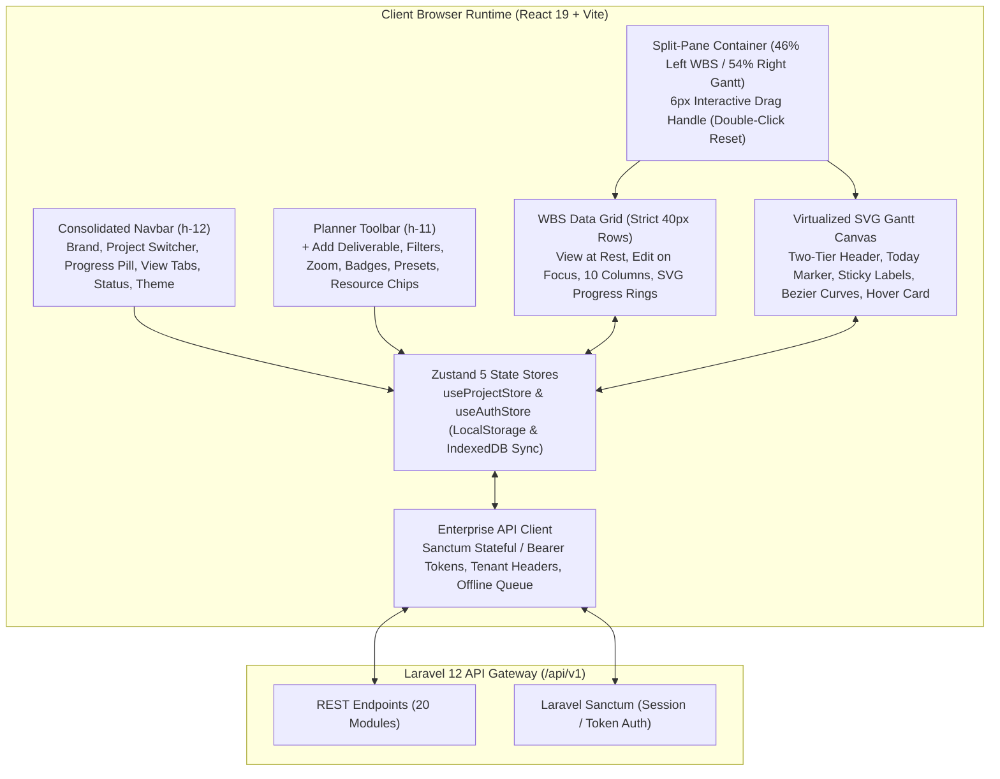

# 07. DeliverOps Frontend Architecture Specification

> **Document ID:** `DOC-07-FRONTEND-ARCHITECTURE`  
> **Status:** Production-Verified / Field-Tested  
> **Version:** 2.2.0 (CLAYGANTT Modern Enterprise Release)  
> **Target Platform:** React 19, TypeScript, Tailwind CSS, Vite, Zustand 5, IndexedDB (`ClayGanttDB`)  
> **Harmonized With:** 01-BUSINESS, 02-FEATURES, 05-BACKEND, 06-API, 12-OPENAPI

---

## 1. Architectural Overview & System Design

DeliverOps utilizes a modern, resilient Single-Page Application (SPA) architecture built on **React 19** and **TypeScript** (strict mode), bundled via **Vite**. The frontend client operates as a reactive execution surface for project delivery workflows, resource capacity balancing, real-time WBS editing, and SVG-based Critical Path Method (CPM) Gantt scheduling known as **CLAYGANTT**.

---

## 2. Shell & Header Consolidation Architecture

The application eliminates multi-bar clutter by establishing **two unified, high-density header bars**:

### 2.1 Primary App Navbar (`Navbar.tsx` - `h-12`)
A single `h-12` header bar (`px-4`, `bg-white dark:bg-[#11161b]`, `border-b border-slate-200 dark:border-slate-800`):
1. **Brand Mark**: `CLAYGANTT` logo with sparkle icon and subtle `WBS Matrix` badge.
2. **Project Switcher Dropdown (`#nav-project-switcher`)**:
   - Active project code (`MAFI-01`) and project name.
   - Dropdown displays all tenant projects with task counts, active indicator, `Browse Templates` button, and `Create Blank Project` button.
3. **Inline Progress Pill**:
   - Compact `31% Complete` text with a 48px micro progress bar, dynamically recalculating from active deliverables.
4. **Sliding Segmented Navigation Tabs (`#nav-views-tabs`)**:
   - `Planner`, `Team's Hub`, `Roles`, `Financials`, `Projects`, `Config`.
   - Subtle background pill with animated transition.
5. **System Status Dot**:
   - `Deliverables System: Active` with green pulsing radar ping.
6. **3-Way Theme Segmented Toggle**:
   - `Light` ($\text{Sun}$) \| `Dark` ($\text{Moon}$) \| `Auto` ($\text{Laptop}$).
7. **Import / Export Menu**:
   - JSON Backup Import, CSV Spreadsheet Import, Bulk Task Import (Dry-Run), JSON Backup Export, CSV / Excel Export.
8. **Action Buttons & Tenant Profile**:
   - Weekly Delivery Report trigger (`#nav-report-btn`), Risk Register trigger (`#nav-risks-btn`), AI Copilot drawer trigger, Command Palette trigger (`⌘K`), Notifications Bell with unread badge, and Tenant Organization avatar flyout.

### 2.2 Planner Toolbar (`PlannerToolbar.tsx` - `h-11`)
The secondary control strip dedicated to execution:
1. **Primary Deliverable Action**:
   - `+ Add Deliverable` button with keyboard shortcut badge (`Cmd+N` / `Ctrl+N`).
2. **History Controls**:
   - `Undo` (`Cmd+Z`) and `Redo` (`Cmd+Shift+Z`) triggers.
3. **Filter Popover & Quick Search**:
   - Filter button with dynamic active count badge (`Filter (2)`).
   - Instant search input filtering deliverables by name, owner, or category.
4. **Segmented Zoom Scale**:
   - `Day` (48px/day), `Week` (16px/day), `Month` (4px/day), `Fit` (auto-fit project span).
5. **Metric Badges**:
   - `Overdue` pill with alert triangle and overdue deliverable count.
   - `Critical Path` pill with flame icon and critical deliverable count.
   - `Locked Baseline` drift pill showing net variance (e.g., `Locked: +4d Drift`).
6. **Layout Preset Toggle**:
   - `Grid` (100% WBS Table) \| `50:50` (Split View) \| `Gantt` (100% Timeline Canvas).
7. **Interactive Resource Capacity Chips**:
   - Horizontal chips showing engineer names and active load days (`Mohamed Salama 1d`, `M.H. 28d`, `O.H. 98d`, `S.N. 114d`, `Z.H. 65d`). Clicking any chip isolates and filters tasks assigned to that resource.

---

## 3. Split-Pane Workspace & Strict 40px Row Alignment

### 3.1 Resizable 46/54 Split-Pane (`PlannerView.tsx`)
- **Default Ratio**: 46% Left WBS Data Grid / 54% Right Gantt Canvas.
- **6px Interactive Drag Handle**:
  - Center grip indicator with hover highlight.
  - Dragging recalculates pane widths in real time.
  - **Double-Click Reset**: Double-clicking the splitter immediately restores the exact 46% / 54% ratio.
- **Synchronized Vertical Scrolling**:
  - Left table scroll container and right Gantt scroll container synchronize their `scrollTop` via passive scroll event listeners, ensuring exact row-to-row alignment at 60 FPS.

### 3.2 WBS Data Grid ("View at Rest, Edit on Focus") (`WBSTable.tsx` & `WBSRow.tsx`)
- **Strict 40px Row Height**: Every deliverable row occupies exactly 40px vertical space.
- **10 Core Columns**:
  1. `Index / Checkbox (w-10)`: Row numbering and selection.
  2. `Deliverable Name (min-w-[280px])`:
     - Circular SVG progress ring (0%–100%) with completion checkmark.
     - Expand/collapse toggle for parent nodes.
     - WBS numbering code (`1.0`, `1.1`).
     - Inline text editing with Esc/Enter commit.
  3. `Category (w-28)`: Rounded color badge.
  4. `Priority (w-24)`: Semantic priority pill (`Urgent`, `High`, `Med`, `Low`).
  5. `Owner / Team (w-36)`: Avatar with primary accountable owner.
  6. `Schedule Range (w-36)`: Combined start $\rightarrow$ end date format (`04 Oct → 15 Oct`).
  7. `Duration & Effort (w-24)`: Dual-value cell displaying working calendar days on top and effort hours below (`10d` / `2d eff`).
  8. `Contextual Actions (Floating Right on Hover)`: Predecessor link trigger, Task details drawer trigger, Delete trigger.

### 3.3 Gantt Canvas (`GanttChart.tsx`, `GanttBar.tsx`, `DependencyCurves.tsx`)
- **Two-Tier Sticky Header (48px)**: Months/Years top tier, Days/Weeks bottom tier with weekend shading (`[5, 6]` MENA or `[0, 6]` Western).
- **Today Marker**: 2px rose (`#f43f5e`) vertical indicator line crossing all rows with a top date badge.
- **Sticky Inner Bar Labels**: Labels stay anchored to the visible portion of the bar (`position: sticky; left: 8px`) during horizontal scrolling.
- **Orthogonal Bezier Dependency Curves**: Smooth SVG vectors connecting predecessor finish edges to successor start edges with arrowheads. Critical path curves glow bright amber/red.
- **200ms Glassmorphic Hover Card**: Hovering over any Gantt bar reveals deliverable details, dates, duration, progress, assigned owner, and predecessor links after a 200ms debounce.

---

## 4. State Management Architecture (Zustand 5)

State is organized into two primary global stores:

### 4.1 Project & Scheduling Store (`useProjectStore.ts`)
- **State Properties**:
  - `projects: Project[]`: Multi-project roster with complete WBS trees, dependencies, baselines, and risks.
  - `activeProjectId: string`: Currently active project ULID.
  - `activeView: ActiveView`: `planner` \| `team` \| `roles` \| `financials` \| `dashboard` \| `config` \| `users` \| `create-role`.
  - `theme: ThemeMode`: `light` \| `dark` \| `system`.
  - `zoomLevel: number`: Pixel width per day (48, 16, 4).
  - `teamMembers: TeamMember[]`: Organization engineers with skills, capacity hours, and status.
- **Persistence & Hydration**:
  - State partialized and persisted to `localStorage` under `claymorphic_gantt_store_v2`.
  - Background synchronization with IndexedDB (`ClayGanttDB`) on load.

### 4.2 Authentication & Identity Store (`useAuthStore.ts`)
- **State Properties**:
  - `user: ApiUser | null`: Authenticated user profile, roles, permissions, and organization memberships.
  - `currentOrganization: ApiOrganization | null`: Active tenant workspace context.
  - `organizations: ApiOrganization[]`: Available tenant workspaces.
  - `isAuthenticated: boolean`: Authentication state.
  - `isMfaRequired: boolean`: MFA challenge state.
- **Persistence & Storage**:
  - Auth token persisted in `deliverops_auth_token`.
  - Active organization ULID persisted in `deliverops_current_org_id`.
  - Cross-tab synchronization via `deliverops_auth_event` storage listener.

---

## 5. Visual Reference Catalogue (33 System Screenshots)

All views, tabs, drawers, and modals are verified and catalogued in [`screenshots/`](file:///d:/Sana%20Soft2/PRoject%20Code/Project%20managment/screenshots):

- [`01_auth_signin_gateway.png`](file:///d:/Sana%20Soft2/PRoject%20Code/Project%20managment/screenshots/01_auth_signin_gateway.png): Sign-in portal with world map backdrop.
- [`02_planner_wbs_gantt_split.png`](file:///d:/Sana%20Soft2/PRoject%20Code/Project%20managment/screenshots/02_planner_wbs_gantt_split.png): 46/54 split-pane workspace with consolidated 2-bar headers.
- [`03_planner_wbs_full_grid.png`](file:///d:/Sana%20Soft2/PRoject%20Code/Project%20managment/screenshots/03_planner_wbs_full_grid.png): Full WBS data grid (Grid preset).
- [`04_planner_gantt_full_timeline.png`](file:///d:/Sana%20Soft2/PRoject%20Code/Project%20managment/screenshots/04_planner_gantt_full_timeline.png): Full Gantt timeline canvas (Gantt preset).
- [`05_planner_gantt_bar_hover_card.png`](file:///d:/Sana%20Soft2/PRoject%20Code/Project%20managment/screenshots/05_planner_gantt_bar_hover_card.png): 200ms glassmorphic hover card & cross-pane row highlight.
- [`06_planner_task_detail_drawer.png`](file:///d:/Sana%20Soft2/PRoject%20Code/Project%20managment/screenshots/06_planner_task_detail_drawer.png): Slide-out task details & comments drawer.
- [`07_planner_dark_mode.png`](file:///d:/Sana%20Soft2/PRoject%20Code/Project%20managment/screenshots/07_planner_dark_mode.png): Full planner workspace in dark mode.
- [`08_team_hub_capacity_matrix.png`](file:///d:/Sana%20Soft2/PRoject%20Code/Project%20managment/screenshots/08_team_hub_capacity_matrix.png): Capacity matrix & workload heatmap.
- [`09_team_hub_members_directory.png`](file:///d:/Sana%20Soft2/PRoject%20Code/Project%20managment/screenshots/09_team_hub_members_directory.png): Team members directory cards.
- [`10_team_hub_skills_matrix.png`](file:///d:/Sana%20Soft2/PRoject%20Code/Project%20managment/screenshots/10_team_hub_skills_matrix.png): Skills matrix table.
- [`11_team_hub_capacity_forecast.png`](file:///d:/Sana%20Soft2/PRoject%20Code/Project%20managment/screenshots/11_team_hub_capacity_forecast.png): Capacity forecast chart & hiring recommendations.
- [`12_team_hub_live_timesheets.png`](file:///d:/Sana%20Soft2/PRoject%20Code/Project%20managment/screenshots/12_team_hub_live_timesheets.png): Live timesheets grid & hours logging.
- [`13_team_hub_time_off_calendar.png`](file:///d:/Sana%20Soft2/PRoject%20Code/Project%20managment/screenshots/13_team_hub_time_off_calendar.png): Time off and leave calendar.
- [`14_users_management_directory.png`](file:///d:/Sana%20Soft2/PRoject%20Code/Project%20managment/screenshots/14_users_management_directory.png): Users management directory table.
- [`15_users_invite_drawer.png`](file:///d:/Sana%20Soft2/PRoject%20Code/Project%20managment/screenshots/15_users_invite_drawer.png): Invite user drawer.
- [`16_roles_management_overview.png`](file:///d:/Sana%20Soft2/PRoject%20Code/Project%20managment/screenshots/16_roles_management_overview.png): Roles management table.
- [`17_roles_create_new_role_matrix.png`](file:///d:/Sana%20Soft2/PRoject%20Code/Project%20managment/screenshots/17_roles_create_new_role_matrix.png): Create role view with permissions matrix.
- [`18_financials_budget_invoicing.png`](file:///d:/Sana%20Soft2/PRoject%20Code/Project%20managment/screenshots/18_financials_budget_invoicing.png): Financials dashboard & SOW milestone invoicing.
- [`19_projects_portfolio_dashboard.png`](file:///d:/Sana%20Soft2/PRoject%20Code/Project%20managment/screenshots/19_projects_portfolio_dashboard.png): Projects portfolio hub cards.
- [`20_config_general_and_calendar.png`](file:///d:/Sana%20Soft2/PRoject%20Code/Project%20managment/screenshots/20_config_general_and_calendar.png): Config working days & holiday calendar.
- [`21_config_wbs_categories.png`](file:///d:/Sana%20Soft2/PRoject%20Code/Project%20managment/screenshots/21_config_wbs_categories.png): Config WBS categories and colors.
- [`22_config_baseline_management.png`](file:///d:/Sana%20Soft2/PRoject%20Code/Project%20managment/screenshots/22_config_baseline_management.png): Baseline lock & schedule drift audit.
- [`23_risk_register_rib_modal.png`](file:///d:/Sana%20Soft2/PRoject%20Code/Project%20managment/screenshots/23_risk_register_rib_modal.png): Risk, Issue & Blocker register modal.
- [`24_weekly_delivery_report_modal.png`](file:///d:/Sana%20Soft2/PRoject%20Code/Project%20managment/screenshots/24_weekly_delivery_report_modal.png): Weekly delivery executive status report modal.
- [`25_org_settings_general_modal.png`](file:///d:/Sana%20Soft2/PRoject%20Code/Project%20managment/screenshots/25_org_settings_general_modal.png): Organization settings modal (General tab).
- [`26_org_settings_members_modal.png`](file:///d:/Sana%20Soft2/PRoject%20Code/Project%20managment/screenshots/26_org_settings_members_modal.png): Organization members & roles tab.
- [`27_template_picker_modal.png`](file:///d:/Sana%20Soft2/PRoject%20Code/Project%20managment/screenshots/27_template_picker_modal.png): Project templates gallery modal.
- [`28_task_bulk_import_modal.png`](file:///d:/Sana%20Soft2/PRoject%20Code/Project%20managment/screenshots/28_task_bulk_import_modal.png): Bulk task import dry-run modal.
- [`29_new_project_creation_modal.png`](file:///d:/Sana%20Soft2/PRoject%20Code/Project%20managment/screenshots/29_new_project_creation_modal.png): Create blank project modal.
- [`30_ai_copilot_assistant_drawer.png`](file:///d:/Sana%20Soft2/PRoject%20Code/Project%20managment/screenshots/30_ai_copilot_assistant_drawer.png): AI Project Copilot assistant drawer.
- [`31_command_palette_modal.png`](file:///d:/Sana%20Soft2/PRoject%20Code/Project%20managment/screenshots/31_command_palette_modal.png): Command Palette modal (`⌘K`).
- [`32_notifications_inbox_drawer.png`](file:///d:/Sana%20Soft2/PRoject%20Code/Project%20managment/screenshots/32_notifications_inbox_drawer.png): Notification center inbox drawer.
- [`33_first_run_install_view.png`](file:///d:/Sana%20Soft2/PRoject%20Code/Project%20managment/screenshots/33_first_run_install_view.png): System first-run setup view (`/install`).
