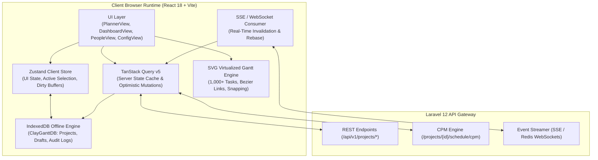
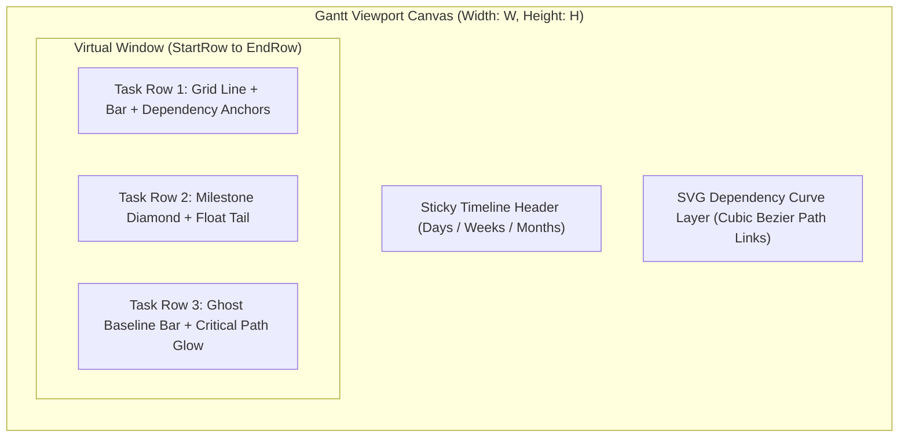
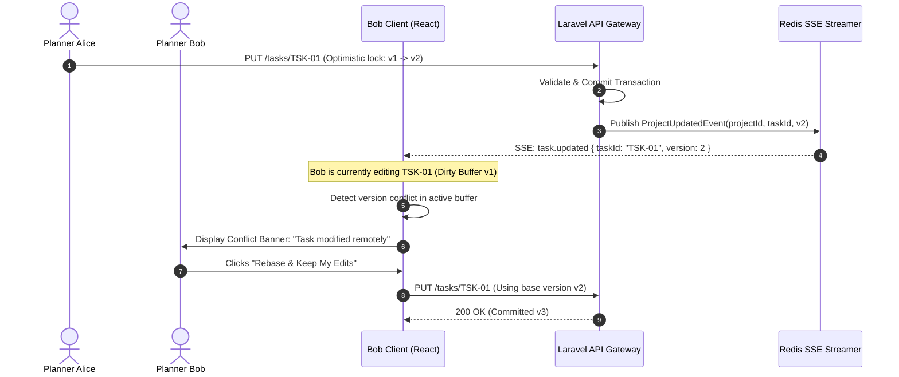

# DeliverOps Frontend Architecture Specification

> **Document ID:** `DOC-07-FRONTEND-ARCHITECTURE`  
> **Status:** Production-Ready / Implementation-Grade  
> **Version:** 2.0.0  
> **Target Platform:** React 18, TypeScript 5.4+, Vite 5+, Zustand, TanStack Query v5, IndexedDB (Dexie/Native)

---

## 1. Architectural Overview & System Design

DeliverOps utilizes a modern, resilient Single-Page Application (SPA) architecture built on **React 18** and **TypeScript** (strict mode), bundled via **Vite**. The frontend client operates as a reactive execution surface for project delivery workflows, resource capacity balancing, real-time WBS editing, and SVG-based Critical Path Method (CPM) Gantt scheduling.



### 1.1 Directory Structure & Monolith Organization
The frontend source code is organized into modular domain features located under `src/`:

```
src/
├── api/                     # Typed Axios / Fetch HTTP clients & endpoint contracts
│   ├── client.ts            # Base Axios instance with Sanctum bearer token & 401 interceptors
│   ├── projects.ts          # Project CRUD & baseline endpoints
│   ├── tasks.ts             # Task CRUD, review decisions, and effort allocations
│   ├── cpm.ts               # CPM calculation trigger & schedule metrics
│   └── risks.ts             # Risk register & task blocker endpoints
├── assets/                  # Static SVGs, icons, typography font files
├── components/              # Modular UI components partitioned by domain
│   ├── auth/                # Login modal, MFA challenge, user profile flyout
│   ├── common/              # Buttons, inputs, modals, toast alerts, status badges
│   ├── gantt/               # Virtualized SVG canvas, dependency lines, milestone diamonds
│   ├── layout/              # AppShell, TopNav, Sidebar, WorkspaceTabs, FlyoutDrawer
│   ├── rbac/                # PermissionGate, RoleSelector, UserManagementTable
│   ├── reports/             # Schedule drift gauge, EVM charts, PDF/Markdown exporters
│   ├── risks/               # Risk matrix (5x5), blocker drawer, mitigation modal
│   ├── team/                # Capacity workload heatmap, member availability cards
│   └── wbs/                 # Hierarchical task tree table, inline cell editors
├── db/                      # IndexedDB persistent layer
│   └── projectDB.ts         # Multi-store transactional storage (ClayGanttDB v2)
├── stores/                  # Global reactive stores
│   ├── useAuthStore.ts      # Authentication session, tokens, user permissions
│   └── useProjectStore.ts   # Active project aggregate, undo/redo stack, UI view modes
├── types/                   # Central domain TypeScript definitions & DTOs
│   └── index.ts             # Task, Project, TeamMember, Risk, CPM, Enums
├── utils/                   # Pure utility functions
│   ├── cpmMath.ts           # Forward/backward pass math, working day calendars
│   ├── dateUtils.ts         # MENA vs Western calendar calculations, ISO parsers
│   └── exportUtils.ts       # CSV/JSON/Markdown report formatters
└── views/                   # Top-level workspace application views
    ├── ConfigView.tsx       # Working calendar, holiday schedule, RBAC settings
    ├── DashboardView.tsx    # Executive KPIs, drift gauges, critical path summaries
    ├── PeopleView.tsx       # Resource directory, skill allocations, capacity balancing
    └── PlannerView.tsx      # Main WBS spreadsheet + SVG Gantt split-pane canvas
```

---

## 2. State Management & Data Layer Architecture

DeliverOps separates **Server Cache State**, **Client UI Session State**, and **Durable Offline State** into distinct tiers to prevent state corruption, race conditions, and uncoordinated re-renders.

### 2.1 State Tiers Matrix

| State Category | Technology | Scope | Persistence | Invalidation Strategy |
| :--- | :--- | :--- | :--- | :--- |
| **Server State** | TanStack Query v5 | Remote database resources (`/api/v1/*`) | Memory cache (staleTime: 30s) | Query key tagging + SSE push mutations |
| **Client UI State**| Zustand v4 | Active filters, selected rows, zoom levels | Session / Memory | Reset on route change / manual action |
| **Offline / Draft**| IndexedDB (`ClayGanttDB`) | Uncommitted task drafts, local audit logs | Persistent Disk | Background sync upon network reconnection |

### 2.2 TanStack Query Conventions & Optimistic Mutation Flow

Query keys follow strict hierarchical tuple paths:

```typescript
// Query Key Factory
export const projectKeys = {
  all: ['projects'] as const,
  lists: () => [...projectKeys.all, 'list'] as const,
  detail: (id: string) => [...projectKeys.all, 'detail', id] as const,
  tasks: (projectId: string) => [...projectKeys.detail(projectId), 'tasks'] as const,
  cpm: (projectId: string) => [...projectKeys.detail(projectId), 'cpm'] as const,
  risks: (projectId: string) => [...projectKeys.detail(projectId), 'risks'] as const,
  baselines: (projectId: string) => [...projectKeys.detail(projectId), 'baselines'] as const,
};
```

#### Optimistic Task Update with Automatic Rollback on Conflict (HTTP 409)
When a user resizes or drags a task bar in the Gantt, DeliverOps immediately applies the date changes optimistically. If another team member has already committed an edit (resulting in an optimistic locking `409 Conflict` or CPM cycle `422 Unprocessable Content`), the UI automatically reverts to the previous snapshot:

```typescript
import { useMutation, useQueryClient } from '@tanstack/react-query';
import { updateTaskApi } from '../api/tasks';
import { Task, ApiErrorResponse } from '../types';
import { projectKeys } from '../api/queryKeys';
import { useToast } from '../components/common/Toast';

export function useOptimisticTaskUpdate(projectId: string) {
  const queryClient = useQueryClient();
  const { showToast } = useToast();

  return useMutation({
    mutationFn: ({ taskId, payload }: { taskId: string; payload: Partial<Task> }) =>
      updateTaskApi(projectId, taskId, payload),

    // 1. Snapshot previous state before applying mutation
    onMutate: async ({ taskId, payload }) => {
      await queryClient.cancelQueries({ queryKey: projectKeys.tasks(projectId) });
      const previousTasks = queryClient.getQueryData<Task[]>(projectKeys.tasks(projectId));

      // Optimistically update query cache
      if (previousTasks) {
        queryClient.setQueryData<Task[]>(projectKeys.tasks(projectId), (old) =>
          old ? old.map((t) => (t.id === taskId ? { ...t, ...payload } : t)) : []
        );
      }

      return { previousTasks };
    },

    // 2. Rollback on failure (e.g. 409 Version Conflict or 422 CPM Cycle)
    onError: (err: ApiErrorResponse, variables, context) => {
      if (context?.previousTasks) {
        queryClient.setQueryData(projectKeys.tasks(projectId), context.previousTasks);
      }
      
      if (err.status === 409) {
        showToast({
          type: 'error',
          title: 'Concurrency Conflict',
          message: 'This task was modified by another user. Re-fetching latest project state...',
        });
      } else if (err.status === 422 && err.error_code === 'CPM_CYCLE_DETECTED') {
        showToast({
          type: 'error',
          title: 'Circular Dependency Rejected',
          message: err.message,
        });
      }
      // Re-fetch to ensure server parity
      queryClient.invalidateQueries({ queryKey: projectKeys.detail(projectId) });
    },

    // 3. Re-sync queries on success
    onSettled: () => {
      queryClient.invalidateQueries({ queryKey: projectKeys.tasks(projectId) });
      queryClient.invalidateQueries({ queryKey: projectKeys.cpm(projectId) });
    },
  });
}
```

### 2.3 IndexedDB Architecture (`projectDB.ts`)
The offline and local-first caching tier uses a native multi-store IndexedDB implementation (`ClayGanttDB`, version 2). It provides transactional guarantees across five discrete stores:

1. `projects`: Complete project aggregates including metadata, configuration, and WBS.
2. `team_members`: Local directory cache of contributors, roles, and skills.
3. `task_comments`: Unsynced collaborative discussion drafts.
4. `audit_logs`: Local client-side activity trail for replay and diagnostic export.
5. `migration_snapshots`: Point-in-time WBS state captures before major structural batch operations.

---

## 3. SVG Gantt Chart Engine & Virtualization Architecture

DeliverOps renders large enterprise schedules (1,000+ tasks) entirely through hardware-accelerated **Scalable Vector Graphics (SVG)**. It avoids DOM bloat and layout thrashing by implementing custom horizontal and vertical virtualization windows.



### 3.1 Dual-Axis Virtualization Algorithm
To achieve a sustained **60 FPS** scroll rate across 1,000+ tasks:
1. **Vertical Virtualization**: Only task rows intersecting the current vertical scroll window ($Y_{\text{top}} - \text{buffer}$ to $Y_{\text{bottom}} + \text{buffer}$) are rendered to the DOM tree. Standard row height is fixed at $h_{\text{row}} = 36\text{px}$.
2. **Horizontal Virtualization**: Only dates within the active horizontal scroll window ($X_{\text{left}} - \text{buffer}$ to $X_{\text{right}} + \text{buffer}$) render grid lines and date header labels.

```typescript
export interface VirtualWindow {
  startIndex: number;
  endIndex: number;
  totalHeight: number;
  offsetY: number;
}

export function calculateVerticalVirtualWindow(
  scrollTop: number,
  viewportHeight: number,
  totalItems: number,
  rowHeight: number = 36,
  bufferItems: number = 5
): VirtualWindow {
  const startIndex = Math.max(0, Math.floor(scrollTop / rowHeight) - bufferItems);
  const visibleCount = Math.ceil(viewportHeight / rowHeight);
  const endIndex = Math.min(totalItems - 1, startIndex + visibleCount + (2 * bufferItems));
  
  return {
    startIndex,
    endIndex,
    totalHeight: totalItems * rowHeight,
    offsetY: startIndex * rowHeight,
  };
}
```

### 3.2 Zoom Level Resolutions

DeliverOps supports three dynamic zoom levels with distinct coordinate-to-time mapping:

| Zoom Level | Resolution ($\text{px}/\text{day}$) | Header Granularity | Grid Snapping Rule |
| :--- | :--- | :--- | :--- |
| **Day** | $48\text{px}$ | Day number + Day-of-week letter | Snaps to exact day boundary ($00:00:00$) |
| **Week** | $16\text{px}$ | Calendar Week number (e.g. `W14`) + Month | Snaps to weekly work-start day |
| **Month** | $4\text{px}$ | Month name (e.g. `Nov 2026`) + Quarter | Snaps to first calendar day of month |

### 3.3 Dependency Curve Rendering (Cubic Bézier)
Dependency lines between predecessor $P$ and successor $S$ are rendered using cubic Bézier paths (`<path d="..." />`) calculated in SVG viewport space:

$$\mathbf{P}_{\text{start}} = (X_{P,\text{end}}, Y_{P,\text{mid}}), \quad \mathbf{P}_{\text{end}} = (X_{S,\text{start}}, Y_{S,\text{mid}})$$

```typescript
export function generateDependencyBezierPath(
  startX: number,
  startY: number,
  endX: number,
  endY: number,
  type: 'FS' | 'SS' | 'FF' = 'FS'
): string {
  const arrowBuffer = 12;
  
  if (type === 'FS') {
    if (endX >= startX + (2 * arrowBuffer)) {
      // Standard forward curve
      const midX = (startX + endX) / 2;
      return `M ${startX} ${startY} C ${midX} ${startY}, ${midX} ${endY}, ${endX} ${endY}`;
    } else {
      // S-curve wrapping around when successor starts before predecessor finishes
      const loopOffset = 18;
      const midY = (startY + endY) / 2;
      return `M ${startX} ${startY} 
              L ${startX + loopOffset} ${startY} 
              C ${startX + loopOffset + 8} ${startY}, ${startX + loopOffset + 8} ${midY}, ${startX + loopOffset} ${midY}
              L ${endX - loopOffset} ${midY}
              C ${endX - loopOffset - 8} ${midY}, ${endX - loopOffset - 8} ${endY}, ${endX - loopOffset} ${endY}
              L ${endX} ${endY}`;
    }
  }
  
  // Finish-to-Finish or Start-to-Start fallback
  return `M ${startX} ${startY} L ${endX} ${endY}`;
}
```

### 3.4 Visual Style Specifications
- **Normal Task Bar**: Rounded rect (`rx="4"`), gradient fill (`#3B82F6` to `#2563EB`), height $20\text{px}$, vertical margin $8\text{px}$.
- **Critical Path Bar**: High-visibility crimson fill (`#EF4444`), neon red drop-shadow filter (`filter="url(#criticalGlow)"`), animated pulsating stroke for active bottlenecks.
- **Milestone**: 45-degree rotated square (Diamond) centered at date anchor, fill `#8B5CF6`, stroke `#6D28D9`.
- **Baseline Ghost Bar**: Semi-transparent slate rect (`fill="#64748B" fill-opacity="0.35"`), rendered directly underneath active bar with dashed boundary for immediate variance detection.
- **Total Float (Slack) Tail**: Dashed horizontal leader line (`stroke="#94A3B8" stroke-dasharray="4,4"`) extending from Early Finish ($EF$) to Late Finish ($LF$).

---

## 4. Real-Time Synchronization & Collaborative Conflicts

DeliverOps maintains project synchronicity across concurrent distributed planners via **Server-Sent Events (SSE)**.



### 4.1 Event Handlers & TanStack Query Invalidation
Incoming SSE frames map directly to granular query invalidation commands:

```typescript
export function initializeProjectEventStream(projectId: string, queryClient: any) {
  const eventSource = new EventSource(`/api/v1/projects/${projectId}/stream`, {
    withCredentials: true,
  });

  eventSource.addEventListener('cpm.recalculated', (e: MessageEvent) => {
    const data = JSON.parse(e.data);
    queryClient.setQueryData(projectKeys.cpm(projectId), data.metrics);
    queryClient.invalidateQueries({ queryKey: projectKeys.tasks(projectId) });
  });

  eventSource.addEventListener('task.blocked', (e: MessageEvent) => {
    const data = JSON.parse(e.data);
    queryClient.invalidateQueries({ queryKey: projectKeys.tasks(projectId) });
    queryClient.invalidateQueries({ queryKey: projectKeys.risks(projectId) });
  });

  eventSource.onerror = () => {
    eventSource.close();
    // Exponential backoff reconnect
    setTimeout(() => initializeProjectEventStream(projectId, queryClient), 5000);
  };

  return () => eventSource.close();
}
```

---

## 5. Accessibility (a11y) & WCAG 2.1 AA Compliance

DeliverOps adheres to **WCAG 2.1 AA** standards across all desktop and tablet interfaces.

### 5.1 Keyboard Navigation & Roving Tabindex in Gantt
Users can navigate the virtualized Gantt canvas and task grid completely without a mouse:

| Key Binding | Target Element | Action Taken |
| :--- | :--- | :--- |
| <kbd>Arrow Up</kbd> / <kbd>Arrow Down</kbd> | Task Row | Moves focus to preceding / succeeding task row |
| <kbd>Arrow Left</kbd> / <kbd>Arrow Right</kbd> | Timeline Bar | Steps task start date by $\pm 1$ working day |
| <kbd>Shift</kbd> + <kbd>Arrow Right</kbd> | Timeline Bar | Resizes duration by $+1$ working day |
| <kbd>Shift</kbd> + <kbd>Arrow Left</kbd> | Timeline Bar | Resizes duration by $-1$ working day (min 1 day) |
| <kbd>Enter</kbd> / <kbd>Space</kbd> | Focused Task | Opens Task Inspector / Detail Drawer |
| <kbd>Delete</kbd> / <kbd>Backspace</kbd> | Dependency Line | Prompts deletion confirmation for dependency link |
| <kbd>Escape</kbd> | Modal / Drawer | Dismisses active drawer; restores focus to origin cell |

### 5.2 ARIA Live Regions for Mathematical Engine Announcements
To inform assistive technologies of dynamic calculations without disrupting navigation, DeliverOps maintains a global polite live region:

```html
<div 
  id="a11y-announcer" 
  aria-live="polite" 
  aria-atomic="true" 
  class="sr-only"
>
  <!-- Dynamically injected: "CPM recalculation complete. Critical path duration: 42 working days. 3 tasks on critical path." -->
</div>
```

---

## 6. Internationalization (i18n), RTL Layout & MENA Calendar Engine

### 6.1 Bi-Directional (RTL) Layout Implementation
For Arabic and Hebrew localizations, DeliverOps configures native CSS Logical Properties (`margin-inline-start`, `padding-inline-end`, `inset-inline-start`) and dynamically flips the SVG Gantt time axis.

```typescript
// Timeline coordinate mapping supporting LTR and RTL
export function dateToCanvasX(
  targetDate: string,
  projectStartDate: string,
  pxPerDay: number,
  totalWidth: number,
  isRtl: boolean = false
): number {
  const daysDiff = differenceInCalendarDays(parseISO(targetDate), parseISO(projectStartDate));
  const ltrX = daysDiff * pxPerDay;
  
  // In RTL, the timeline flows from right (X = totalWidth) to left (X = 0)
  return isRtl ? totalWidth - ltrX : ltrX;
}
```

### 6.2 MENA Working Calendar & Statutory Holiday Handling
The scheduling frontend supports regional working week conventions:
- **Western Standard**: Working days = Monday through Friday (Weekend: Saturday, Sunday).
- **MENA Standard (GCC / Levant)**: Working days = Sunday through Thursday (Weekend: Friday, Saturday).

```typescript
export interface WorkingCalendarConfig {
  weekendDays: number[]; // e.g. [5, 6] for Friday/Saturday or [0, 6] for Sunday/Saturday
  holidays: string[];    // Array of ISO dates 'YYYY-MM-DD'
}

export function isWorkingDay(date: Date, config: WorkingCalendarConfig): boolean {
  const dayOfWeek = date.getDay(); // 0 = Sunday, 5 = Friday, 6 = Saturday
  if (config.weekendDays.includes(dayOfWeek)) {
    return false;
  }
  const dateString = date.toISOString().split('T')[0];
  return !config.holidays.includes(dateString);
}
```
If a user drags a task bar over a Friday or Saturday on a MENA project, the SVG canvas magnetically snaps the bar boundary to Sunday morning ($00:00:00$).

---

## 7. Quality Gates & Frontend Verification Matrix

| Area | Target Metric | Verification Method | Enforcement Gate |
| :--- | :--- | :--- | :--- |
| **Gantt Rendering** | $\ge 58\text{ FPS}$ with 1,000 tasks | Chrome DevTools Performance Timeline Profiler | Automated Playwright Benchmark |
| **Bundle Size** | $< 350\text{ KB}$ gzipped (initial chunk) | Rollup Visualizer Bundle Audit | CI GitHub Actions limit check |
| **Accessibility** | 100% WCAG 2.1 AA pass | Axe-core + Lighthouse Accessibility Audit | Zero violations in CI E2E run |
| **Type Safety** | 0 `any` types, strict null checks | `tsc --noEmit` | Pre-commit Git Hook + CI Pipeline |
