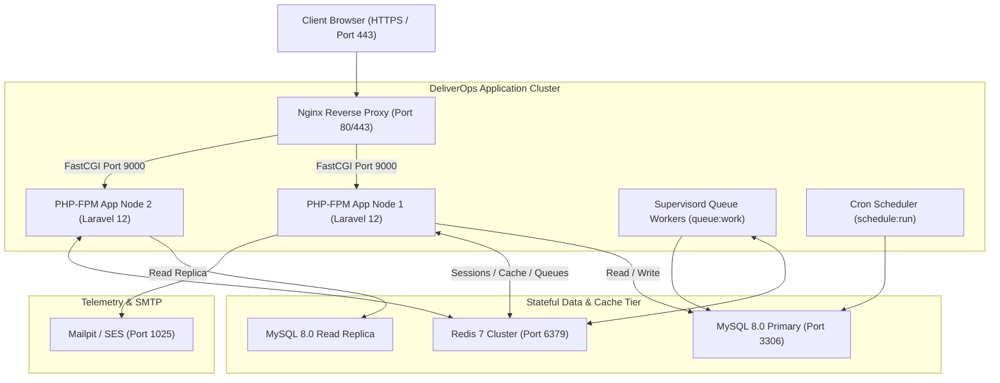

# DeliverOps Deployment and Operations Specification

> **Document ID:** `DOC-08-DEPLOYMENT-AND-OPERATIONS`  
> **Status:** Production-Ready / Implementation-Grade  
> **Version:** 2.2.0  
> **Target Environment:** Docker, Kubernetes / Linux VMs (Ubuntu 22.04 LTS), GitHub Actions CI/CD, MySQL 8.0, Redis 7  
> **Harmonized With:** [01-BUSINESS](file:///d:/Sana%20Soft2/PRoject%20Code/Project%20managment/docs/01-BUSINESS-AND-DOMAIN.md), [05-BACKEND](file:///d:/Sana%20Soft2/PRoject%20Code/Project%20managment/docs/05-BACKEND-ARCHITECTURE.md), [06-API](file:///d:/Sana%20Soft2/PRoject%20Code/Project%20managment/docs/06-API-REFERENCE.md), [07-FRONTEND](file:///d:/Sana%20Soft2/PRoject%20Code/Project%20managment/docs/07-FRONTEND-ARCHITECTURE.md), [09-SECURITY](file:///d:/Sana%20Soft2/PRoject%20Code/Project%20managment/docs/09-SECURITY-AND-COMPLIANCE.md), [16-RUNBOOKS](file:///d:/Sana%20Soft2/PRoject%20Code/Project%20managment/docs/16-RUNBOOKS.md)

---

## 1. Multi-Container Docker Architecture

DeliverOps is packaged as an immutable, multi-container architecture. For local engineering and single-node staging environments, services are orchestrated via Docker Compose. In production, containers are deployed across a load-balanced container orchestrator (ECS / EKS / Nomads).



### 1.1 Complete `docker-compose.yml` Specification

```yaml
version: '3.8'

services:
  # 1. Reverse Proxy & Static Asset Server
  nginx:
    image: nginx:1.25-alpine
    container_name: deliverops-nginx
    restart: unless-stopped
    ports:
      - "80:80"
      - "443:443"
    volumes:
      - ./docker/nginx/default.conf:/etc/nginx/conf.d/default.conf:ro
      - ./docker/nginx/ssl:/etc/nginx/ssl:ro
      - ./backend/public:/var/www/html/public:ro
    depends_on:
      - app
    networks:
      - deliverops-network

  # 2. Primary Laravel PHP-FPM Application Runtime
  app:
    build:
      context: ./backend
      dockerfile: Dockerfile
    container_name: deliverops-app
    restart: unless-stopped
    environment:
      APP_ENV: production
      APP_DEBUG: "false"
      APP_KEY: ${APP_KEY}
      DB_CONNECTION: mysql
      DB_HOST: db
      DB_PORT: 3306
      DB_DATABASE: deliverops
      DB_USERNAME: deliverops_user
      DB_PASSWORD: ${DB_PASSWORD}
      REDIS_HOST: redis
      REDIS_PORT: 6379
      CACHE_STORE: redis
      QUEUE_CONNECTION: redis
      SESSION_DRIVER: redis
    volumes:
      - ./backend/storage:/var/www/html/storage
    depends_on:
      - db
      - redis
    networks:
      - deliverops-network

  # 3. Dedicated Asynchronous Queue Worker Container
  queue-worker:
    build:
      context: ./backend
      dockerfile: Dockerfile
    container_name: deliverops-worker
    restart: unless-stopped
    command: ["supervisord", "-c", "/etc/supervisor/conf.d/supervisord.conf"]
    environment:
      APP_ENV: production
      APP_DEBUG: "false"
      APP_KEY: ${APP_KEY}
      DB_HOST: db
      REDIS_HOST: redis
      QUEUE_CONNECTION: redis
    volumes:
      - ./backend/storage:/var/www/html/storage
    depends_on:
      - app
      - redis
    networks:
      - deliverops-network

  # 4. Scheduled Cron Runner Container
  scheduler:
    build:
      context: ./backend
      dockerfile: Dockerfile
    container_name: deliverops-scheduler
    restart: unless-stopped
    command: ["/bin/sh", "-c", "while true; do php /var/www/html/artisan schedule:run --verbose --no-interaction & sleep 60; done"]
    environment:
      APP_ENV: production
      APP_KEY: ${APP_KEY}
      DB_HOST: db
      REDIS_HOST: redis
    depends_on:
      - app
    networks:
      - deliverops-network

  # 5. MySQL 8.0 Primary Database
  db:
    image: mysql:8.0
    container_name: deliverops-mysql
    restart: unless-stopped
    environment:
      MYSQL_ROOT_PASSWORD: ${DB_ROOT_PASSWORD}
      MYSQL_DATABASE: deliverops
      MYSQL_USER: deliverops_user
      MYSQL_PASSWORD: ${DB_PASSWORD}
    command: >
      --default-authentication-plugin=mysql_native_password
      --character-set-server=utf8mb4
      --collation-server=utf8mb4_unicode_ci
      --innodb_buffer_pool_size=1G
      --innodb_log_file_size=256M
      --max_connections=250
    volumes:
      - mysql-data:/var/lib/mysql
    networks:
      - deliverops-network

  # 6. Redis In-Memory Cache, Queue, and Session Broker
  redis:
    image: redis:7-alpine
    container_name: deliverops-redis
    restart: unless-stopped
    command: ["redis-server", "--appendonly", "yes", "--requirepass", "${REDIS_PASSWORD}"]
    volumes:
      - redis-data:/data
    networks:
      - deliverops-network

  # 7. Local SMTP Interceptor (Dev / Staging Only)
  mailpit:
    image: axllent/mailpit:latest
    container_name: deliverops-mailpit
    ports:
      - "8025:8025"
    networks:
      - deliverops-network

networks:
  deliverops-network:
    driver: bridge

volumes:
  mysql-data:
    driver: local
  redis-data:
    driver: local
```

### 1.2 Optimized Production Dockerfile (`backend/Dockerfile`)

```dockerfile
FROM php:8.2-fpm-alpine

# Install system build dependencies and runtime packages
RUN apk add --no-cache \
    bash \
    curl \
    freetype-dev \
    git \
    icu-dev \
    libjpeg-turbo-dev \
    libpng-dev \
    libzip-dev \
    oniguruma-dev \
    supervisor \
    unzip \
    zip

# Install and configure required PHP extensions for High-Performance CPM & DB operations
RUN docker-php-ext-configure gd --with-freetype --with-jpeg \
    && docker-php-ext-install -j$(nproc) \
        bcmath \
        gd \
        intl \
        mbstring \
        opcache \
        pdo_mysql \
        zip

# Install Redis extension from PECL
RUN apk add --no-cache --virtual .build-deps $PHPIZE_DEPS \
    && pecl install redis \
    && docker-php-ext-enable redis \
    && apk del .build-deps

# Copy optimized OPcache settings
COPY ./docker/php/opcache.ini /usr/local/etc/php/conf.d/opcache.ini

# Install Composer
COPY --from=composer:2.7 /usr/bin/composer /usr/bin/composer

WORKDIR /var/www/html

# Copy application source
COPY . /var/www/html

# Install production dependencies without dev packages
RUN composer install --no-dev --optimize-autoloader --no-interaction

# Set appropriate directory permissions for storage and bootstrap caches
RUN chown -R www-data:www-data /var/www/html/storage /var/www/html/bootstrap/cache \
    && chmod -R 775 /var/www/html/storage /var/www/html/bootstrap/cache

EXPOSE 9000
CMD ["php-fpm"]
```

---

### 1.3 First-Run Installation & Migration Provisioning

DeliverOps provides an automated two-path installation workflow for initializing bare-metal, VM, or containerized deployments:

#### Option A: Headless CLI Orchestration (`deliverops:install`)
For CI/CD automated deployments, Infrastructure as Code, or container entrypoints:

```bash
# 1. Ensure Spatie Teams multi-tenancy configuration is active
php artisan deliverops:prepare-spatie-teams

# 2. Run automated installer: applies all 51 migrations, seeds RBAC & templates, creates admin & tenant
php artisan deliverops:install --force
```

**What `deliverops:install` accomplishes automatically:**
1. **Validates Spatie Teams Prerequisite**: Confirms `config('permission.teams') === true`.
2. **Runs 51 Database Migrations**: Executes all schema migrations in strict chronological order with foreign keys and index constraints.
3. **Idempotency Guard**: Checks `InstallState::isInstalled()` singleton to prevent re-initializing active systems.
4. **Executes `InstallationOrchestrator`**:
   - Provisions the primary tenant (`organizations` table with ULID).
   - Provisions default roles and 55+ permissions across all 20 modules.
   - Generates the root SuperAdmin user with strict password validation.
   - Binds the SuperAdmin to the tenant using Spatie Teams (`team_id = organization.id`).
   - Seeds standard project templates, WBS phase structures, and risk categories.
   - Writes the immutable `install_state` record marking the system as operational.

#### Option B: Web-Based Setup Wizard (`/install`)
For manual deployments, DeliverOps renders a high-density, step-by-step installer at `/install` (Visual Reference: [33_first_run_install_view.png](file:///d:/Sana%20Soft2/PRoject%20Code/Project%20managment/screenshots/33_first_run_install_view.png)):
- **Step 1: System Pre-Flight**: Verifies PHP 8.2+, extensions (`bcmath`, `intl`, `pdo_mysql`, `redis`), directory permissions (`storage/`, `bootstrap/cache/`), and database connectivity.
- **Step 2: Database Migration**: Applies 51 schema migrations with real-time SSE progress reporting.
- **Step 3: Root Organization & SuperAdmin**: Prompts for organization name, slug, administrator email, and password.
- **Step 4: Activation**: Locks the install gateway and transitions directly to the login portal.

---

### 1.4 Operations & Troubleshooting CLI Commands

| Command | Purpose | Parameters / Options |
| :--- | :--- | :--- |
| `php artisan deliverops:install` | Complete automated platform provisioning | `--force`: Bypass production warning prompt |
| `php artisan deliverops:prepare-spatie-teams` | Configures and validates Spatie Teams config | Automatically verifies `team_id` / `organization_id` alignment |
| `php artisan deliverops:unlock-user {email}` | Unlocks an account locked due to failed login attempts | `{email}`: Target user's registered email |
| `php artisan queue:work redis` | Processes asynchronous background queue jobs | `--sleep=3`, `--tries=3`, `--timeout=60` |
| `php artisan schedule:run` | Triggers scheduled maintenance, reminders & auto-schedulers | Recommended cron execution frequency: every 1 minute |

---

## 2. Production CI/CD Pipeline (GitHub Actions)

DeliverOps uses a strict quality gate in `.github/workflows/deploy.yml`. No code reaches production without passing static analysis, linting, unit tests, and Playwright end-to-end suites.

```yaml
name: DeliverOps Production CI/CD Pipeline

on:
  push:
    branches: [ main ]
  pull_request:
    branches: [ main ]

jobs:
  # ----------------------------------------------------
  # STAGE 1: Code Style & Static Analysis
  # ----------------------------------------------------
  code-quality:
    name: Code Quality & Static Analysis
    runs-on: ubuntu-latest
    steps:
      - name: Checkout Source Code
        uses: actions/checkout@v4

      - name: Setup PHP 8.2
        uses: shivammathur/setup-php@v2
        with:
          php-version: '8.2'
          extensions: mbstring, bcmath, pdo_mysql, intl
          tools: composer:v2

      - name: Cache Composer Dependencies
        uses: actions/cache@v3
        with:
          path: backend/vendor
          key: ${{ runner.os }}-composer-${{ hashFiles('backend/composer.lock') }}

      - name: Install Composer Dependencies
        working-directory: ./backend
        run: composer install --prefer-dist --no-interaction

      - name: Verify Code Style (Laravel Pint)
        working-directory: ./backend
        run: ./vendor/bin/pint --test

      - name: Static Analysis (PHPStan Level 8)
        working-directory: ./backend
        run: ./vendor/bin/phpstan analyse --level=8 app/

      - name: Setup Node.js 20
        uses: actions/setup-node@v4
        with:
          node-version: 20
          cache: 'npm'

      - name: Install Frontend Dependencies
        run: npm ci

      - name: TypeScript Strict Check
        run: npx tsc --noEmit

      - name: ESLint Check
        run: npx eslint src/ --max-warnings 0

  # ----------------------------------------------------
  # STAGE 2: Automated Testing (Backend & Frontend)
  # ----------------------------------------------------
  automated-tests:
    name: Automated Test Suite (Pest & Playwright)
    needs: code-quality
    runs-on: ubuntu-latest
    services:
      mysql:
        image: mysql:8.0
        env:
          MYSQL_ROOT_PASSWORD: root
          MYSQL_DATABASE: deliverops_test
        ports:
          - 3306:3306
        options: --health-cmd="mysqladmin ping" --health-interval=10s --health-timeout=5s --health-retries=3
      redis:
        image: redis:7-alpine
        ports:
          - 6379:6379

    steps:
      - name: Checkout Source Code
        uses: actions/checkout@v4

      - name: Setup PHP
        uses: shivammathur/setup-php@v2
        with:
          php-version: '8.2'
          extensions: mbstring, bcmath, pdo_mysql, redis

      - name: Install Composer Dependencies
        working-directory: ./backend
        run: composer install --prefer-dist --no-interaction

      - name: Execute Backend Tests & CPM Invariant Verification
        working-directory: ./backend
        env:
          DB_CONNECTION: mysql
          DB_HOST: 127.0.0.1
          DB_PORT: 3306
          DB_DATABASE: deliverops_test
          DB_USERNAME: root
          DB_PASSWORD: root
        run: php artisan test --parallel --coverage-clover=coverage.xml

      - name: Verify Coverage Threshold (>85%)
        working-directory: ./backend
        run: |
          php -r '
          $xml = simplexml_load_file("coverage.xml");
          $elements = (int)$xml->project->metrics["elements"];
          $covered = (int)$xml->project->metrics["coveredelements"];
          $pct = ($elements > 0) ? ($covered / $elements) * 100 : 0;
          echo "Test Coverage: " . round($pct, 2) . "%\n";
          if ($pct < 85.0) {
            echo "ERROR: Code coverage below 85% requirement.\n";
            exit(1);
          }
          '

      - name: Build Frontend Application
        run: |
          npm ci
          npm run build

  # ----------------------------------------------------
  # STAGE 3: Zero-Downtime Production Deployment
  # ----------------------------------------------------
  deploy:
    name: Zero-Downtime Deployment
    needs: automated-tests
    if: github.ref == 'refs/heads/main'
    runs-on: ubuntu-latest
    steps:
      - name: Deploy via SSH Key & Atomic Symlink Switch
        uses: appleboy/ssh-action@master
        with:
          host: ${{ secrets.PROD_HOST }}
          username: deploy
          key: ${{ secrets.PROD_SSH_PRIVATE_KEY }}
          script: |
            set -e
            DEPLOY_PATH="/var/www/deliverops"
            RELEASE_NAME=$(date +%Y%m%d%H%M%S)
            RELEASE_DIR="$DEPLOY_PATH/releases/$RELEASE_NAME"

            echo "Cloning release into $RELEASE_DIR..."
            git clone --depth 1 -b main git@github.com:myorg/deliverops.git $RELEASE_DIR

            cd $RELEASE_DIR/backend
            cp $DEPLOY_PATH/shared/.env .env
            composer install --no-dev --optimize-autoloader --no-interaction
            php artisan config:cache
            php artisan route:cache
            php artisan view:cache
            php artisan migrate --force

            cd $RELEASE_DIR
            npm ci
            npm run build

            # Atomic Symlink Switch
            echo "Executing atomic symlink switch to $RELEASE_NAME..."
            ln -nfs $RELEASE_DIR $DEPLOY_PATH/current

            # Restart Queue Workers & Reload PHP-FPM
            sudo supervisorctl restart all
            sudo systemctl reload php8.2-fpm
            sudo systemctl reload nginx

            # Retain only last 5 releases
            cd $DEPLOY_PATH/releases && ls -t | tail -n +6 | xargs -r rm -rf
            echo "Deployment completed successfully."
```

---

## 3. Background Queue Workers & Scheduler Operations

### 3.1 Queue Worker Taxonomy & Priorities
DeliverOps background tasks are partitioned across three dedicated queues:

1. `cpm`: Dedicated to mathematical DAG calculations, forward/backward passes, and topological cycles. High CPU allocation, low concurrency to avoid thrashing.
2. `notifications`: Email digests, webhook deliveries, and external integration dispatches. High concurrency, I/O bound.
3. `default`: General housekeeping, export generation, and audit trail aggregation.

#### Supervisord Production Worker Configuration (`/etc/supervisor/conf.d/supervisord.conf`)

```ini
[supervisord]
nodaemon=true
logfile=/var/log/supervisor/supervisord.log
pidfile=/var/run/supervisord.pid

[program:deliverops-worker-cpm]
process_name=%(program_name)s_%(process_num)02d
command=php /var/www/html/artisan queue:work redis --queue=cpm --tries=3 --timeout=120 --max-time=3600 --max-jobs=500 --memory=256
autostart=true
autorestart=true
stopasgroup=true
killasgroup=true
user=www-data
numprocs=2
redirect_stderr=true
stdout_logfile=/var/www/html/storage/logs/worker-cpm.log

[program:deliverops-worker-general]
process_name=%(program_name)s_%(process_num)02d
command=php /var/www/html/artisan queue:work redis --queue=notifications,default --tries=3 --timeout=60 --max-time=3600 --memory=128
autostart=true
autorestart=true
stopasgroup=true
killasgroup=true
user=www-data
numprocs=4
redirect_stderr=true
stdout_logfile=/var/www/html/storage/logs/worker-general.log
```

### 3.2 Scheduled Task Schedule (`app/Console/Kernel.php`)

```php
protected function schedule(Schedule $schedule): void
{
    // 1. Daily Midnight Schedule Drift & Float Degradation Recalculation
    $schedule->command('deliverops:recalculate-drifts')
        ->dailyAt('00:05')
        ->withoutOverlapping()
        ->runInBackground()
        ->appendOutputTo(storage_path('logs/scheduler-drifts.log'));

    // 2. Hourly Risk Exposure Matrix Scoring & Automated Task Blocker Verification
    $schedule->command('deliverops:evaluate-risk-blockers')
        ->hourly()
        ->withoutOverlapping();

    // 3. Weekly Friday Midnight Database Pruning (Expired Idempotency Keys & Old Audit Replicas)
    $schedule->command('deliverops:prune-idempotency-keys')
        ->weeklyOn(5, '23:30');
}
```

---

## 4. Redis Caching Architecture & Invalidation Protocol

DeliverOps leverages Redis 7 for high-speed cache storage with granular key namespacing and tag-based atomic invalidation:

### 4.1 Cache Key Taxonomy

| Cache Key Pattern | TTL | Payload | Invalidation Trigger |
| :--- | :--- | :--- | :--- |
| `project:{id}:summary` | 300s | Project progress %, open risks, task counts | Any task or risk update in project |
| `project:{id}:cpm_result` | 3600s | Complete CPM early/late dates & critical path | Task duration, link, or calendar change |
| `user:{id}:permissions` | 86400s | Array of granted Spatie permission strings | Role assignment or policy edit |
| `global:holidays:{calendarId}` | 604800s | Array of statutory holiday dates | Working calendar configuration change |

### 4.2 Cache Tagging Implementation

```php
namespace App\Modules\Projects\Services;

use Illuminate\Support\Facades\Cache;

class ProjectCacheService
{
    public function getProjectSummary(string $projectId): array
    {
        return Cache::tags(["project:{$projectId}"])->remember("summary", 300, function () use ($projectId) {
            return $this->computeSummaryMetrics($projectId);
        });
    }

    public function invalidateProject(string $projectId): void
    {
        // Atomically purge all cached queries for this project
        Cache::tags(["project:{$projectId}"])->flush();
    }
}
```

---

## 5. Backup, Disaster Recovery & High Availability

### 5.1 Automated Database Backup Script (`scripts/backup-db.sh`)

```bash
#!/usr/bin/env bash
set -eo pipefail

BACKUP_DATE=$(date +%Y%m%d_%H%M%S)
BACKUP_DIR="/var/backups/deliverops"
FILENAME="deliverops_${BACKUP_DATE}.sql.gz"
S3_BUCKET="s3://deliverops-database-backups-prod"

mkdir -p "$BACKUP_DIR"

echo "Starting consistent logical backup of DeliverOps MySQL..."

# Perform non-locking consistent mysqldump
mysqldump \
  --host="${DB_HOST:-127.0.0.1}" \
  --port=3306 \
  --user="${DB_USERNAME}" \
  --password="${DB_PASSWORD}" \
  --single-transaction \
  --quick \
  --routines \
  --triggers \
  --default-character-set=utf8mb4 \
  deliverops | gzip -9 > "${BACKUP_DIR}/${FILENAME}"

echo "Backup created at ${BACKUP_DIR}/${FILENAME}. Uploading to encrypted S3 storage..."

# Upload to AWS S3 with server-side AES-256 encryption
aws s3 cp "${BACKUP_DIR}/${FILENAME}" "${S3_BUCKET}/${FILENAME}" --sse aws:kms

# Retain only last 7 days of local backups
find "$BACKUP_DIR" -type f -name "deliverops_*.sql.gz" -mtime +7 -delete

echo "Backup operations completed successfully."
```

### 5.2 Disaster Recovery Metrics & Point-in-Time Runbook

| Metric | Target SLA | Implementation Strategy |
| :--- | :--- | :--- |
| **Recovery Point Objective (RPO)** | $\le 15\text{ minutes}$ | Automated hourly full dumps + continuous MySQL Binary Log shipping to S3 |
| **Recovery Time Objective (RTO)** | $\le 60\text{ minutes}$ | Containerized deployment orchestration; single-command restoration script |

#### Database Restoration Command Runbook
```bash
# 1. Download snapshot from secure object store
aws s3 cp s3://deliverops-database-backups-prod/deliverops_20261012_120000.sql.gz ./restore.sql.gz

# 2. Decompress and restore into target database inside Docker
gunzip < ./restore.sql.gz | docker exec -i deliverops-mysql mysql -u deliverops_user -p${DB_PASSWORD} deliverops

# 3. Clear application caches and re-evaluate queue jobs
docker exec deliverops-app php artisan cache:clear
docker exec deliverops-app php artisan queue:restart
```

---

## 6. Horizontal Scaling & Database Read/Write Splitting

To scale DeliverOps beyond 50,000 active tasks across enterprise tenants, the application configures MySQL Read/Write splitting within `backend/config/database.php`:

```php
'mysql' => [
    'read' => [
        'host' => [
            env('DB_READ_HOST_1', '10.0.1.101'),
            env('DB_READ_HOST_2', '10.0.1.102'),
        ],
    ],
    'write' => [
        'host' => [
            env('DB_WRITE_HOST', '10.0.1.100'),
        ],
    ],
    'sticky' => true, // Reads in the same request after a write always hit primary
    'driver' => 'mysql',
    'database' => env('DB_DATABASE', 'deliverops'),
    'username' => env('DB_USERNAME', 'deliverops_user'),
    'password' => env('DB_PASSWORD', ''),
    'charset' => 'utf8mb4',
    'collation' => 'utf8mb4_unicode_ci',
    'prefix' => '',
    'strict' => true,
    'engine' => 'InnoDB',
],
```
When configured with `sticky => true`, any write query (e.g. creating a baseline version or updating a task) automatically directs subsequent reads within that same request lifecycle to the primary write host, preventing read-after-write replication lag artifacts.
