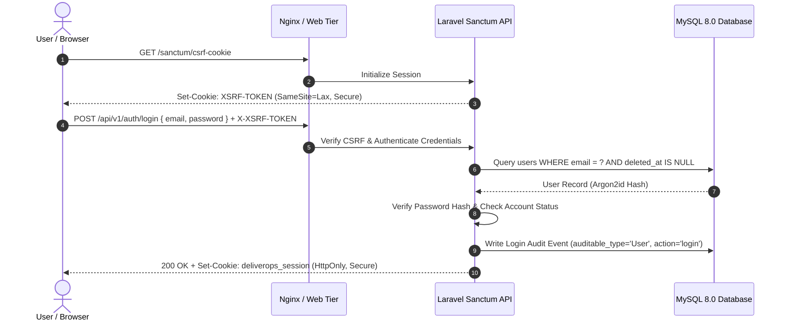
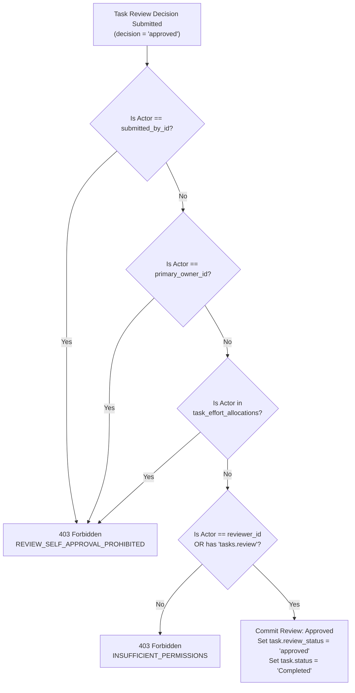

# DeliverOps Security and Compliance Specification

> **Document ID:** `DOC-09-SECURITY-AND-COMPLIANCE`  
> **Status:** Production-Ready / Implementation-Grade  
> **Version:** 2.0.0  
> **Standards:** OWASP Top 10 (2021), SOC 2 Type II, GDPR (EU 2016/679), ISO/IEC 27001

---

## 1. Authentication Architecture & Token Lifecycle

DeliverOps implements a defense-in-depth authentication framework powered by **Laravel Sanctum**. It supports two distinct authentication modalities:

1. **Stateful Session Authentication (SPA Client)**: Secure, encrypted, `HttpOnly` cookie-backed sessions for browser clients with automated CSRF protection.
2. **Stateless Personal Access Tokens (API / Mobile)**: SHA-256 hashed bearer tokens for programmatic API access and automated pipeline integrations.



### 1.1 Token Configuration & Security Parameters

| Parameter | SPA Session Cookie | API Personal Access Token |
| :--- | :--- | :--- |
| **Storage Mechanism** | `HttpOnly`, `Secure`, `SameSite=Lax` Cookie | Client Secure Storage (Encrypted Keyring / Secret) |
| **Hash Algorithm** | Encrypted via AES-256-CBC (`APP_KEY`) | SHA-256 (`hash('sha256', $plainTextToken)`) |
| **Default Lifetime** | 120 minutes (inactivity timeout) | 30 days (configurable up to 90 days) |
| **CSRF Requirement** | Mandatory double-submit cookie verification | Exempt (Protected by Bearer signature) |
| **Revocation Method** | Session invalidation (`Auth::logout()`) | Database record deletion in `personal_access_tokens` |

---

## 2. Authorization, Spatie RBAC & Privilege Escalation Defenses

DeliverOps enforces a strict, hierarchical Role-Based Access Control (RBAC) model implemented via `spatie/laravel-permission`.

### 2.1 Role Hierarchy Matrix

```
┌────────────────────────────────────────────────────────┐
│                        Admin                           │
│  (Full system management, user provisioning, global)   │
└───────────────────────────┬────────────────────────────┘
                            │
┌───────────────────────────▼────────────────────────────┐
│                   Project Manager                      │
│   (WBS edits, CPM recalculation, baseline creation)    │
└───────────────────────────┬────────────────────────────┘
                            │
┌───────────────────────────▼────────────────────────────┐
│                     Contributor                        │
│   (Task status updates, comment logs, review submit)   │
└───────────────────────────┬────────────────────────────┘
                            │
┌───────────────────────────▼────────────────────────────┐
│                       Viewer                           │
│       (Read-only inspection of Gantt & Dashboards)     │
└────────────────────────────────────────────────────────┘
```

### 2.2 Privilege Escalation Defenses & Guard Invariants

A critical vulnerability in multi-tier enterprise applications is horizontal and vertical privilege escalation. DeliverOps enforces three hard architectural invariants at the service and controller layer that **bypass rules like `Gate::before` cannot circumvent**:

#### Invariant 1: Self-Deletion Protection
No user—including a System Administrator—may delete their own account. This prevents accidental lockout and audit evasion.

#### Invariant 2: Last Admin Invariant
The last remaining active Administrator in the system cannot be deleted or have their `admin` role revoked.

#### Invariant 3: Privilege Ceilings on Role Assignment
A user can only assign roles that are equal to or lower than their own highest role in the role hierarchy. A Project Manager cannot elevate themselves or another user to Administrator.

```php
namespace App\Modules\Users\Services;

use App\Models\User;
use App\Exceptions\SecurityException;
use Illuminate\Support\Facades\DB;

class UserSecurityService
{
    /**
     * Enforce strict privilege escalation invariants upon user modification.
     */
    public function ensureCanAssignRoles(User $actor, User $target, array $rolesToAssign): void
    {
        // 1. Invariant: Only Admin can grant the 'admin' role
        if (in_array('admin', $rolesToAssign) && !$actor->hasRole('admin')) {
            throw new SecurityException('PRIVILEGE_ESCALATION_BLOCKED', 'Non-administrators cannot grant the admin role.');
        }

        // 2. Invariant: Prevent stripping admin from the last remaining active admin
        if ($target->hasRole('admin') && !in_array('admin', $rolesToAssign)) {
            $adminCount = User::role('admin')->whereNull('deleted_at')->lockForUpdate()->count();
            if ($adminCount <= 1) {
                throw new SecurityException('LAST_ADMIN_PROTECTED', 'Cannot remove the last remaining active system administrator.');
            }
        }
    }

    /**
     * Enforce invariants prior to user deletion.
     */
    public function ensureCanDeleteUser(User $actor, User $target): void
    {
        // 1. Self-deletion guard
        if ($actor->id === $target->id) {
            throw new SecurityException('SELF_DELETION_PROHIBITED', 'You cannot delete your own account.');
        }

        // 2. Last admin guard
        if ($target->hasRole('admin')) {
            $adminCount = User::role('admin')->whereNull('deleted_at')->lockForUpdate()->count();
            if ($adminCount <= 1) {
                throw new SecurityException('LAST_ADMIN_PROTECTED', 'Cannot delete the last remaining active system administrator.');
            }
        }
    }
}
```

---

## 3. Anti-Self-Approval Review Enforcement

To guarantee quality governance and separation of duties, DeliverOps mandates the **Anti-Self-Approval Rule** on all deliverables moving through the review gate.

### 3.1 Domain Rule Specification
A user $U$ is strictly prohibited from approving a task review decision if $U$ satisfies **any** of the following conditions:
1. $U$ is the **Submitter** of the review request (`task.submitted_by_id == U.id`).
2. $U$ is the **Primary Owner** assigned to the task (`task.primary_owner_id == U.id`).
3. $U$ is an **Effort Contributor** with hours allocated in `task_effort_allocations` (`member_id == U.id`).



### 3.2 Automated Enforcement Implementation (`ReviewWorkflowService.php`)

```php
public function processReviewDecision(Task $task, User $actor, string $decision, ?string $note): Task
{
    if ($decision === 'approved') {
        // Enforce Anti-Self-Approval Guard
        $isSubmitter = ($task->submitted_by_id === $actor->id);
        $isPrimaryOwner = ($task->primary_owner_id === $actor->id);
        $isEffortContributor = $task->effortAllocations()
            ->where('member_id', $actor->id)
            ->exists();

        if ($isSubmitter || $isPrimaryOwner || $isEffortContributor) {
            throw new HttpResponseException(response()->json([
                'success' => false,
                'error_code' => 'REVIEW_SELF_APPROVAL_PROHIBITED',
                'message' => 'Anti-self-approval rule violation: Authors, primary owners, and contributors cannot approve their own tasks.',
            ], 403));
        }
    }

    // Process valid transition
    $task->review_status = ($decision === 'approved') ? 'approved' : 'changes_requested';
    $task->status = ($decision === 'approved') ? 'Completed' : 'In Progress';
    $task->review_note = $note;
    $task->save();

    return $task;
}
```

---

## 4. Audit Trail Immutability & Forensic Logging

Every destructive, administrative, or state-changing operation in DeliverOps generates an unalterable, non-cascading audit trail in `audit_logs`.

### 4.1 Immutability Guarantees
1. **Append-Only Schema**: The `audit_logs` table does not feature an `updated_at` column.
2. **No Update / Delete Endpoints**: No REST controller, API route, or administrative interface exposes `PUT`, `PATCH`, or `DELETE` methods against `audit_logs`.
3. **Database-Level Trigger Guard**: In production, a MySQL trigger prevents `UPDATE` or `DELETE` executions on `audit_logs`:

```sql
DELIMITER $$
CREATE TRIGGER trg_audit_logs_immutable_update
BEFORE UPDATE ON audit_logs
FOR EACH ROW
BEGIN
    SIGNAL SQLSTATE '45000'
    SET MESSAGE_TEXT = 'DELIVEROPS SECURITY VIOLATION: Records in audit_logs are immutable and cannot be updated.';
END$$

CREATE TRIGGER trg_audit_logs_immutable_delete
BEFORE DELETE ON audit_logs
FOR EACH ROW
BEGIN
    SIGNAL SQLSTATE '45000'
    SET MESSAGE_TEXT = 'DELIVEROPS SECURITY VIOLATION: Records in audit_logs are immutable and cannot be deleted.';
END$$
DELIMITER ;
```

### 4.2 Non-Cascading Soft Delete Preservation
Foreign key constraints linking `audit_logs` to `users` or `projects` utilize `ON DELETE RESTRICT` or retain ULID references without cascading:

```sql
CREATE TABLE audit_logs (
    id CHAR(26) NOT NULL PRIMARY KEY,
    auditable_type VARCHAR(64) NOT NULL,
    auditable_id CHAR(26) NOT NULL,
    actor_id CHAR(26) NULL,
    action VARCHAR(32) NOT NULL,
    old_values JSON NULL,
    new_values JSON NULL,
    ip_address VARCHAR(45) NOT NULL,
    user_agent VARCHAR(255) NULL,
    created_at TIMESTAMP NOT NULL DEFAULT CURRENT_TIMESTAMP,
    INDEX idx_audit_target (auditable_type, auditable_id),
    INDEX idx_audit_actor (actor_id),
    INDEX idx_audit_created (created_at)
) ENGINE=InnoDB DEFAULT CHARSET=utf8mb4 COLLATE=utf8mb4_unicode_ci;
```

---

## 5. Web Application Hardening & Defenses

### 5.1 HTTP Security Headers (Nginx & Middleware)
DeliverOps enforces comprehensive security headers across all responses:

```nginx
# Nginx Security Headers Configuration
add_header X-Frame-Options "DENY" always;
add_header X-Content-Type-Options "nosniff" always;
add_header X-XSS-Protection "1; mode=block" always;
add_header Referrer-Policy "strict-origin-when-cross-origin" always;
add_header Strict-Transport-Security "max-age=31536000; includeSubDomains; preload" always;
add_header Content-Security-Policy "default-src 'self'; script-src 'self'; style-src 'self' 'unsafe-inline' https://fonts.googleapis.com; font-src 'self' https://fonts.gstatic.com; img-src 'self' data:; connect-src 'self' https://api.deliverops.internal;" always;
```

### 5.2 SQL Injection & Parameterized Execution
- **Strict Eloquent & PDO Usage**: Direct variable concatenation inside `DB::raw()` is strictly prohibited by automated static analysis (`PHPStan` + custom architecture rule).
- All queries utilize prepared statements with named or positional bindings.

### 5.3 Cross-Site Scripting (XSS) Sanitization
- User comments, task descriptions, and risk mitigation strategies are sanitized via `DOMPurify` before rendering on the React client.
- Laravel JSON outputs are escaped by default (`{{ ... }}`).

### 5.4 Rate Limiting & Throttling Tiers
Tiered rate limits protect authentication and compute-intensive endpoints from brute force and denial-of-service attacks:

| Tier | Route Group | Limit | Decay Period | Action on Exceed |
| :--- | :--- | :--- | :--- | :--- |
| **Auth** | `/api/v1/auth/*` | 5 requests | 60 seconds | `429 Too Many Requests` + `AUTH_RATE_LIMITED` |
| **API** | `/api/v1/*` | 60 requests | 60 seconds | `429 Too Many Requests` + `REQUEST_RATE_LIMITED` |
| **CPM** | `*/schedule/cpm` | 10 requests | 60 seconds | `429 Too Many Requests` + `CPM_RATE_LIMITED` |

---

## 6. Regulatory Compliance & Data Governance

### 6.1 GDPR Article 17 (Right to Erasure) & Pseudonymization
To reconcile GDPR's "Right to be Forgotten" with immutable audit compliance requirements, DeliverOps implements **Pseudonymization on Deletion**:

When an administrative user triggers an account erasure:
1. Personal attributes in `users` (`name`, `email`, `avatar_path`, `phone`) are permanently replaced with cryptographically pseudorandom strings:
   - `name` $\to$ `"Anonymized User [ULID]"`
   - `email` $\to$ `"anonymized_[ULID]@deliverops.internal"`
   - `avatar_path` $\to$ `NULL`
2. The user record is soft-deleted (`deleted_at = NOW()`).
3. Historic `audit_logs` retain the `actor_id` ULID for non-repudiation, but contain no Personally Identifiable Information (PII).

### 6.2 Data Encryption at Rest & in Transit
- **In Transit**: All network communications require TLS 1.3 (with TLS 1.2 fallback using high-strength cipher suites). Plain HTTP requests are redirected to HTTPS via 301 Permanent Redirects.
- **At Rest**: 
  - Database volumes and automated backup archives use **AES-256** encryption.
  - File attachments uploaded to storage disks are encrypted using server-side keys before storage.
