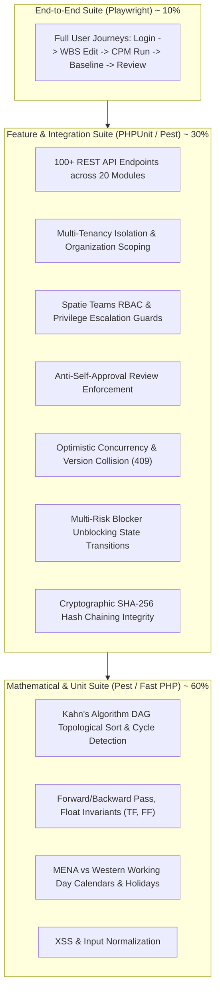

# DeliverOps Testing Strategy Specification

> **Document ID:** `DOC-10-TESTING-STRATEGY`  
> **Status:** Production-Ready / Implementation-Grade  
> **Version:** 2.2.0  
> **Test Frameworks:** PHPUnit 11 / Pest PHP v2, Playwright 1.42+, PHPStan Level 8, Mockery  
> **Harmonized With:** [01-BUSINESS](file:///d:/Sana%20Soft2/PRoject%20Code/Project%20managment/docs/01-BUSINESS-AND-DOMAIN.md), [05-BACKEND](file:///d:/Sana%20Soft2/PRoject%20Code/Project%20managment/docs/05-BACKEND-ARCHITECTURE.md), [06-API](file:///d:/Sana%20Soft2/PRoject%20Code/Project%20managment/docs/06-API-REFERENCE.md), [07-FRONTEND](file:///d:/Sana%20Soft2/PRoject%20Code/Project%20managment/docs/07-FRONTEND-ARCHITECTURE.md), [08-DEPLOYMENT](file:///d:/Sana%20Soft2/PRoject%20Code/Project%20managment/docs/08-DEPLOYMENT-AND-OPERATIONS.md), [09-SECURITY](file:///d:/Sana%20Soft2/PRoject%20Code/Project%20managment/docs/09-SECURITY-AND-COMPLIANCE.md)

---

## 1. Testing Pyramid & Verification Framework

DeliverOps follows a rigorous testing pyramid architecture to guarantee absolute correctness across mathematical scheduling, security policies, concurrency control, and user interactions.



---

## 2. CPM Mathematical Scheduling Engine Test Suite

The CPM Scheduling Engine (`App\Modules\Scheduling\Services\CpmSchedulingService`) is verified against formal graph theory and mathematical scheduling invariants.

### 2.1 Cycle Detection & Kahn's Algorithm Test Cases

```php
namespace Tests\Unit\Scheduling;

use PHPUnit\Framework\TestCase;
use App\Modules\Scheduling\Services\CpmSchedulingService;
use App\Modules\Scheduling\Exceptions\CycleDetectedException;

class CpmCycleDetectionTest extends TestCase
{
    private CpmSchedulingService $service;

    protected function setUp(): void
    {
        parent::setUp();
        $this->service = new CpmSchedulingService();
    }

    /**
     * Invariant: Directed cycles must be aborted immediately.
     */
    public function test_it_detects_simple_two_node_cycle(): void
    {
        $this->expectException(CycleDetectedException::class);
        $this->expectExceptionMessageMatches('/Circular dependency detected/');

        $tasks = [
            ['id' => 'A', 'duration' => 3, 'dependencies' => ['B']],
            ['id' => 'B', 'duration' => 2, 'dependencies' => ['A']],
        ];

        $this->service->calculateProjectSchedule($tasks);
    }

    public function test_it_detects_indirect_three_node_cycle(): void
    {
        $this->expectException(CycleDetectedException::class);

        // A -> B -> C -> A
        $tasks = [
            ['id' => 'A', 'duration' => 5, 'dependencies' => ['C']],
            ['id' => 'B', 'duration' => 4, 'dependencies' => ['A']],
            ['id' => 'C', 'duration' => 2, 'dependencies' => ['B']],
        ];

        $this->service->calculateProjectSchedule($tasks);
    }

    public function test_it_resolves_complex_dag_with_multiple_roots_and_sinks(): void
    {
        // Valid DAG: 
        //   Root1 -> TaskA \
        //                   -> TaskC -> Sink
        //   Root2 -> TaskB /
        $tasks = [
            ['id' => 'Root1', 'duration' => 2, 'dependencies' => []],
            ['id' => 'Root2', 'duration' => 3, 'dependencies' => []],
            ['id' => 'TaskA', 'duration' => 4, 'dependencies' => ['Root1']],
            ['id' => 'TaskB', 'duration' => 2, 'dependencies' => ['Root2']],
            ['id' => 'TaskC', 'duration' => 5, 'dependencies' => ['TaskA', 'TaskB']],
            ['id' => 'Sink',  'duration' => 1, 'dependencies' => ['TaskC']],
        ];

        $result = $this->service->calculateProjectSchedule($tasks);
        
        $this->assertCount(6, $result['tasks']);
        $this->assertEquals(12, $result['critical_path_duration_days']);
    }
}
```

### 2.2 Mathematical Forward and Backward Pass Invariants

The backward pass must ensure that every task on the critical path satisfies the invariant:

$$\text{Total Float } (TF) = LF - EF = LS - ES = 0$$

```php
public function test_cpm_mathematical_float_and_critical_path_invariants(): void
{
    // Task Chain:
    // A (5d) -> B (10d) [Critical Chain = 15d]
    // A (5d) -> C (3d)  [Non-critical: TF = 7d]
    $tasks = [
        ['id' => 'A', 'duration' => 5, 'dependencies' => []],
        ['id' => 'B', 'duration' => 10, 'dependencies' => ['A']],
        ['id' => 'C', 'duration' => 3, 'dependencies' => ['A']],
    ];

    $schedule = $this->service->calculateProjectSchedule($tasks);
    $taskMap = collect($schedule['tasks'])->keyBy('id');

    // 1. Invariant: Critical Tasks have TF = 0
    $this->assertEquals(0, $taskMap['A']['total_float']);
    $this->assertTrue($taskMap['A']['is_critical']);

    $this->assertEquals(0, $taskMap['B']['total_float']);
    $this->assertTrue($taskMap['B']['is_critical']);

    // 2. Invariant: Non-critical Task C has positive float
    $this->assertEquals(7, $taskMap['C']['total_float']);
    $this->assertFalse($taskMap['C']['is_critical']);

    // 3. Invariant: TF == LF - EF == LS - ES
    $taskC = $taskMap['C'];
    $this->assertEquals($taskC['late_finish_day'] - $taskC['early_finish_day'], $taskC['total_float']);
    $this->assertEquals($taskC['late_start_day'] - $taskC['early_start_day'], $taskC['total_float']);
}
```

---

## 3. Anti-Self-Approval & Security Test Suite

Anti-Self-Approval and privilege escalation invariants are enforced by automated integration tests located in `backend/tests/Feature/Security/`.

```php
namespace Tests\Feature\Security;

use Tests\TestCase;
use App\Models\User;
use App\Models\Project;
use App\Models\Task;
use App\Models\TaskEffortAllocation;
use Illuminate\Foundation\Testing\RefreshDatabase;

class AntiSelfApprovalTest extends TestCase
{
    use RefreshDatabase;

    private User $author;
    private User $primaryOwner;
    private User $contributor;
    private User $independentReviewer;
    private Project $project;
    private Task $task;

    protected function setUp(): void
    {
        parent::setUp();

        $this->author = User::factory()->create(['name' => 'Author User']);
        $this->primaryOwner = User::factory()->create(['name' => 'Primary Owner']);
        $this->contributor = User::factory()->create(['name' => 'Effort Contributor']);
        $this->independentReviewer = User::factory()->create(['name' => 'Independent PM']);

        $this->project = Project::factory()->create(['owner_id' => $this->independentReviewer->id]);

        $this->task = Task::factory()->create([
            'project_id' => $this->project->id,
            'submitted_by_id' => $this->author->id,
            'primary_owner_id' => $this->primaryOwner->id,
            'reviewer_id' => $this->independentReviewer->id,
            'status' => 'In Review',
            'review_status' => 'pending_review',
        ]);

        TaskEffortAllocation::create([
            'task_id' => $this->task->id,
            'member_id' => $this->contributor->id,
            'allocated_hours' => 20,
        ]);
    }

    public function test_submitter_cannot_approve_own_task(): void
    {
        $response = $this->actingAs($this->author)
            ->postJson("/api/v1/projects/{$this->project->id}/tasks/{$this->task->id}/review", [
                'decision' => 'approved',
                'note' => 'Self-approving my own submission',
            ]);

        $response->assertStatus(403)
            ->assertJson([
                'success' => false,
                'error_code' => 'REVIEW_SELF_APPROVAL_PROHIBITED',
            ]);
    }

    public function test_primary_owner_cannot_approve_own_task(): void
    {
        $response = $this->actingAs($this->primaryOwner)
            ->postJson("/api/v1/projects/{$this->project->id}/tasks/{$this->task->id}/review", [
                'decision' => 'approved',
            ]);

        $response->assertStatus(403)
            ->assertJson([
                'error_code' => 'REVIEW_SELF_APPROVAL_PROHIBITED',
            ]);
    }

    public function test_effort_contributor_cannot_approve_own_task(): void
    {
        $response = $this->actingAs($this->contributor)
            ->postJson("/api/v1/projects/{$this->project->id}/tasks/{$this->task->id}/review", [
                'decision' => 'approved',
            ]);

        $response->assertStatus(403)
            ->assertJson([
                'error_code' => 'REVIEW_SELF_APPROVAL_PROHIBITED',
            ]);
    }

    public function test_independent_designated_reviewer_can_approve_task(): void
    {
        $response = $this->actingAs($this->independentReviewer)
            ->postJson("/api/v1/projects/{$this->project->id}/tasks/{$this->task->id}/review", [
                'decision' => 'approved',
                'note' => 'Verified deliverable against acceptance criteria.',
            ]);

        $response->assertStatus(200)
            ->assertJson([
                'success' => true,
                'data' => [
                    'review_status' => 'approved',
                    'status' => 'Completed',
                ],
            ]);
    }
}
```

---

## 4. Concurrency & Optimistic Locking Test Suite

Tests verify that concurrent edits using stale versions correctly return HTTP `409 Conflict`.

```php
public function test_optimistic_locking_prevents_stale_overwrites(): void
{
    $task = Task::factory()->create([
        'project_id' => $this->project->id,
        'name' => 'Initial Task Name',
        'version' => 1,
    ]);

    // User A updates task from v1 -> v2
    $responseA = $this->actingAs($this->independentReviewer)
        ->putJson("/api/v1/projects/{$this->project->id}/tasks/{$task->id}", [
            'name' => 'Updated by User A',
            'version' => 1,
        ]);
    $responseA->assertStatus(200);

    // User B attempts update with stale v1
    $responseB = $this->actingAs($this->author)
        ->putJson("/api/v1/projects/{$this->project->id}/tasks/{$task->id}", [
            'name' => 'Conflicting Update by User B',
            'version' => 1,
        ]);

    $responseB->assertStatus(409)
        ->assertJson([
            'success' => false,
            'error_code' => 'CONCURRENCY_CONFLICT',
        ]);
}
```

---

## 5. Playwright End-to-End (E2E) Test Suite

E2E tests in `tests/e2e/project-delivery-flow.spec.ts` simulate authentic browser interactions across the full project lifecycle:

```typescript
import { test, expect } from '@playwright/test';

test.describe('DeliverOps Complete Delivery Workflow', () => {
  test('Planner builds WBS, calculates CPM, creates Baseline, and submits for Review', async ({ page }) => {
    // 1. Authenticate as Project Manager
    await page.goto('/login');
    await page.fill('input[name="email"]', 'pm@deliverops.internal');
    await page.fill('input[name="password"]', 'Password123!');
    await page.click('button[type="submit"]');
    await expect(page).toHaveURL('/projects');

    // 2. Open Project Planner View
    await page.click('text=Enterprise Warehouse Automation');
    await expect(page.locator('h1')).toContainText('Enterprise Warehouse Automation');

    // 3. Add Task and Set Dependencies in WBS
    await page.click('button#add-task-btn');
    await page.fill('input#new-task-name', 'Deploy Edge Controller Cluster');
    await page.fill('input#new-task-duration', '5');
    await page.click('button#save-new-task');

    // 4. Trigger CPM Calculation
    await page.click('button#recalculate-cpm-btn');
    await expect(page.locator('#a11y-announcer')).toContainText('CPM recalculation complete');

    // 5. Verify Critical Path Highlighting on SVG Gantt
    const criticalBar = page.locator('svg.gantt-canvas rect.critical-path-bar').first();
    await expect(criticalBar).toBeVisible();

    // 6. Freeze Baseline Snapshot
    await page.click('button#baseline-menu-btn');
    await page.click('text=Capture New Baseline');
    await page.fill('input#baseline-label', 'V1.0 Contractual Target');
    await page.click('button#confirm-baseline-btn');
    await expect(page.locator('text=Baseline captured successfully')).toBeVisible();

    // 7. Request Sign-Off Review
    await page.click('text=Deploy Edge Controller Cluster');
    await page.click('button#submit-review-btn');
    await expect(page.locator('span.badge-status')).toContainText('In Review');
  });
});
```

---

## 6. Continuous Integration Quality Gates & Benchmark Limits

Every pull request must clear the automated gates below before merge approval:

| Quality Gate | Minimum Requirement | Enforcement Tool | Action on Breach |
| :--- | :--- | :--- | :--- |
| **Test Suite Pass Rate** | $100\%$ green (0 failures) | Pest / PHPUnit | PR Merge Blocked |
| **Code Coverage** | $\ge 85.0\%$ lines & branches | Xdebug / PCOV Clover | CI Job Fails |
| **Static Analysis** | 0 errors at Level 8 | PHPStan (`--level=8`) | CI Job Fails |
| **Frontend Type Safety** | 0 errors | `tsc --noEmit` | CI Job Fails |
| **Code Style** | 0 formatting violations | Laravel Pint & ESLint | Auto-format & Reject |
| **CPM Benchmark** | $< 150\text{ ms}$ for 500 tasks | Automated Pest Benchmark | Flag for Architecture Review |
