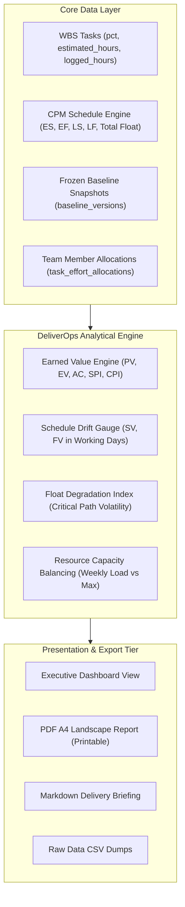
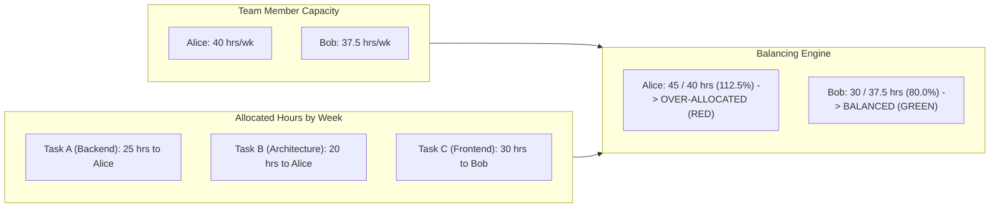

# DeliverOps Reporting and Analytics Specification

> **Document ID:** `DOC-11-REPORTING-AND-ANALYTICS`  
> **Status:** Production-Ready / Implementation-Grade  
> **Version:** 2.2.0  
> **Target Framework:** Earned Value Management (EVM), CPM Drift Analytics, Multi-Format Exporters  
> **Harmonized With:** [01-BUSINESS](file:///d:/Sana%20Soft2/PRoject%20Code/Project%20managment/docs/01-BUSINESS-AND-DOMAIN.md), [02-FEATURES](file:///d:/Sana%20Soft2/PRoject%20Code/Project%20managment/docs/02-FEATURES-AND-PAGES.md), [03-CRUD](file:///d:/Sana%20Soft2/PRoject%20Code/Project%20managment/docs/03-CRUD-SPECIFICATIONS.md), [05-BACKEND](file:///d:/Sana%20Soft2/PRoject%20Code/Project%20managment/docs/05-BACKEND-ARCHITECTURE.md), [06-API](file:///d:/Sana%20Soft2/PRoject%20Code/Project%20managment/docs/06-API-REFERENCE.md), [07-FRONTEND](file:///d:/Sana%20Soft2/PRoject%20Code/Project%20managment/docs/07-FRONTEND-ARCHITECTURE.md)

---

## 1. Executive Dashboard KPIs & Mathematical Formulas

The DeliverOps Reporting Engine translates low-level task progress, CPM float metrics, and resource allocations into standardized executive health indicators.



### 1.1 Core KPI Definitions & Equations

| Metric Name | Symbol | Mathematical Formulation | Interpretation & Healthy Threshold |
| :--- | :---: | :--- | :--- |
| **Progress %** | $P_{\text{proj}}$ | $\frac{\sum_{i=1}^{N} (\text{task}_i.\text{pct} \times \text{task}_i.\text{est\_hours})}{\sum_{i=1}^{N} \text{task}_i.\text{est\_hours}}$ | Weighted percent complete across work packages. Healthy: Matches target plan. |
| **Planned Value** | $PV$ | $\sum_{i \in \text{Scheduled}} \text{task}_i.\text{est\_hours}$ | Total effort planned to be completed by current status date. |
| **Earned Value** | $EV$ | $\sum_{i=1}^{N} (\frac{\text{task}_i.\text{pct}}{100} \times \text{task}_i.\text{est\_hours})$ | Quantified value of work actually completed. |
| **Actual Cost** | $AC$ | $\sum_{i=1}^{N} \text{task}_i.\text{logged\_hours}$ | Actual engineering hours recorded against deliverables. |
| **Schedule Variance** | $SV_{\text{hours}}$ | $EV - PV$ | Positive ($>0$): Ahead of schedule.<br>Negative ($<0$): Behind schedule. |
| **Schedule Perf. Index** | $SPI$ | $\frac{EV}{PV}$ | $\ge 1.0$: On or ahead of target.<br>$< 0.90$: High delivery risk. |
| **Cost Perf. Index** | $CPI$ | $\frac{EV}{AC}$ | $\ge 1.0$: Effort efficient.<br>$< 0.85$: Significant effort overrun. |
| **Schedule Drift** | $D_{\text{days}}$ | $\text{Current End Date} - \text{Baseline End Date}$ | Measured in project working days against active baseline version. |

---

## 2. Schedule Drift Gauge & Health Classification

The **Schedule Drift Gauge** provides delivery leads with an at-a-glance visualization of overall project delay relative to the approved contractual baseline version.

### 2.1 Working-Day Drift Calculation

Given project baseline finish date $B_{\text{finish}}$ and current dynamic CPM project finish date $C_{\text{finish}}$:

$$D_{\text{working}} = \text{CountWorkingDays}(B_{\text{finish}}, C_{\text{finish}}, \text{calendarConfig})$$

### 2.2 Health Status Thresholds

```
   Ahead / On Plan              Minor Slippage               Critical Slippage
 [≤ 0 Working Days]          [1 - 5 Working Days]           [> 5 Working Days]
┌───────────────────────────┬─────────────────────────────┬───────────────────────────┐
│       NORMAL (GREEN)      │       WARNING (AMBER)       │      CRITICAL (RED)       │
│ Project is delivering on  │ Buffer is eroding; near-    │ Critical path breached;   │
│ or ahead of commitments.  │ critical paths threatened.  │ contractual deadline at risk.
└───────────────────────────┴─────────────────────────────┴───────────────────────────┘
```

```typescript
export type ProjectHealthStatus = 'green' | 'amber' | 'red';

export function evaluateProjectHealth(
  driftDays: number,
  criticalPathSlipped: boolean,
  spi: number
): { status: ProjectHealthStatus; message: string } {
  if (driftDays > 5 || criticalPathSlipped || spi < 0.85) {
    return {
      status: 'red',
      message: `Critical slippage detected (+${driftDays} working days, SPI: ${spi.toFixed(2)}). Immediate intervention required.`,
    };
  }
  
  if (driftDays > 0 || spi < 0.95) {
    return {
      status: 'amber',
      message: `Project trending behind baseline (+${driftDays} working days, SPI: ${spi.toFixed(2)}). Total float is eroding.`,
    };
  }

  return {
    status: 'green',
    message: `Project delivery healthy (${driftDays <= 0 ? 'On Schedule' : 'Ahead'}, SPI: ${spi.toFixed(2)}).`,
  };
}
```

---

## 3. Float Degradation Index (FDI) & Critical Path Volatility

A project may display zero schedule drift today while quietly accumulating severe delivery risk because non-critical tasks have consumed all available slack (Total Float).

### 3.1 Float Degradation Equation
The **Float Degradation Index ($FDI$)** measures the rate at which total float is consumed across non-critical paths:

$$FDI = 1 - \frac{\sum_{i \notin CP} TF_{\text{current}, i}}{\sum_{i \notin CP} TF_{\text{baseline}, i}}$$

- $FDI = 0$: Float intact. All buffers fully preserved.
- $0 < FDI \le 0.50$: Moderate float erosion. Normal during execution.
- $FDI > 0.75$: Severe degradation. Secondary paths are on the verge of becoming critical (Near-Critical Chains where $0 < TF \le 2\text{ days}$).

---

## 4. Resource Workload & Capacity Balancing Engine

DeliverOps prevents engineer burnout and hidden bottlenecks through real-time workload balancing.



### 4.1 Over-Allocation Detection Algorithm

```typescript
export interface MemberWeeklyWorkload {
  memberId: string;
  memberName: string;
  weekNumber: number;
  capacityHours: number;
  allocatedHours: number;
  utilizationPct: number;
  status: 'under' | 'balanced' | 'over';
}

export function calculateWeeklyUtilization(
  capacityHours: number,
  allocatedHours: number
): { utilizationPct: number; status: 'under' | 'balanced' | 'over' } {
  if (capacityHours <= 0) {
    return { utilizationPct: 0, status: allocatedHours > 0 ? 'over' : 'balanced' };
  }
  
  const pct = Math.round((allocatedHours / capacityHours) * 100);
  
  if (pct > 100) return { utilizationPct: pct, status: 'over' };
  if (pct < 60)  return { utilizationPct: pct, status: 'under' };
  return { utilizationPct: pct, status: 'balanced' };
}
```

---

## 5. Multi-Format Exporters Specification

DeliverOps provides three native export pipelines: Executive Markdown Briefings, Tabular Data (CSV/Excel), and High-Fidelity Printable PDF Reports.

### 5.1 Executive Markdown Briefing Template

Generated via `GET /api/v1/projects/{id}/reports/markdown`:

```markdown
# DeliverOps Project Status Briefing
**Project Name:** Enterprise Automation System  
**Project Code:** EAS-2026  
**Status Date:** 2026-10-12  
**Baseline Version:** Baseline v1.0 (Locked: 2026-09-01)  

---

## Executive Summary
- **Overall Progress:** 68.4% (Weighted Effort)
- **Schedule Health:** WARNING (Amber)
- **Contractual Drift:** +3 Working Days
- **SPI (Schedule Performance Index):** 0.94
- **CPI (Cost Performance Index):** 0.98

---

## Critical Path Delivery Chain
| Task ID | Deliverable Name | Start Date | End Date | Float | Owner | Status |
| :--- | :--- | :--- | :--- | :---: | :--- | :--- |
| `TSK-010` | PLC Controller Flash | 2026-10-14 | 2026-10-18 | 0d | Alice Reed | In Progress |
| `TSK-015` | Safety Circuit Certification | 2026-10-19 | 2026-10-25 | 0d | John Doe | Not Started |
| `TSK-022` | Factory Acceptance Test (FAT) | 2026-10-26 | 2026-11-02 | 0d | Bob Taylor | Not Started |

---

## Active Risk Exposure
- **Open Risks:** 3 (1 Critical, 1 High, 1 Medium)
- **Blocked Tasks:** 2 deliverables currently blocked by open risks.
- **Top Blocker:** `RSK-003` - International Port Customs Delay (Affecting `TSK-008`).

---
*Report generated automatically by DeliverOps Engine.*
```

### 5.2 High-Fidelity Printable PDF Export (A4 Landscape)
- **Layout**: 297mm $\times$ 210mm (Landscape A4).
- **Header**: Enterprise logo, project metadata, status date, and security classification (`CONFIDENTIAL`).
- **Section 1**: KPI Executive Cards (Progress %, Drift Days, SPI, CPI, Critical Path Duration).
- **Section 2**: Vector SVG Gantt Snapshot rendering up to 60 days of the project horizon with critical path glow and baseline ghost bars.
- **Section 3**: Critical Path & Near-Critical Chain Table.
- **Section 4**: Risk Register Matrix (5x5 Heatmap) & Blocker Resolution Log.
- **Footer**: Generation timestamp, actor name, non-repudiation cryptographic verification hash.
