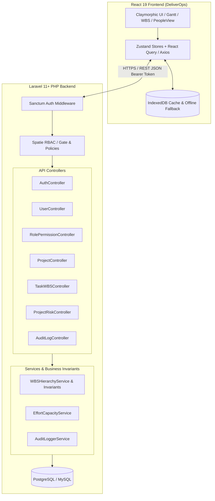
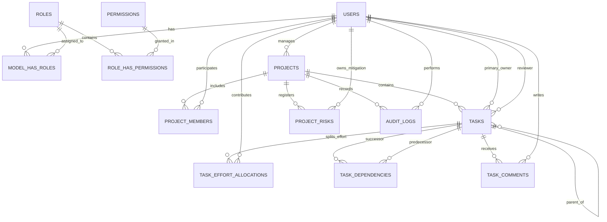
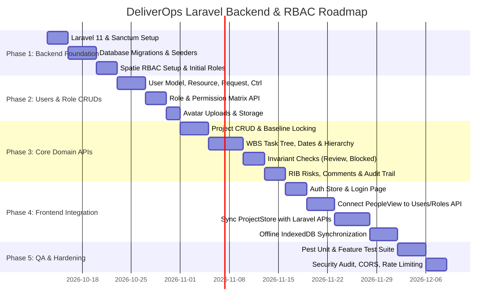

# 🚀 DeliverOps: Full-Stack Laravel Backend & RBAC Implementation Plan

> **System**: DeliverOps Enterprise Project Delivery & Resource Management Platform  
> **Backend Framework**: Laravel 11 / 12 (PHP 8.2+)  
> **Frontend**: React 19 + TypeScript + Vite + Tailwind CSS + Zustand  
> **Security & RBAC**: Laravel Sanctum + Spatie Laravel-Permission  
> **Primary Database**: PostgreSQL 16+ or MySQL 8.0+  
> **Target Status**: Production-Ready Architectural Blueprint & Phased Execution

---

## 1. System Architecture Overview

Currently, DeliverOps runs as an offline-first Single Page Application with client-side state in Zustand and persistent storage in IndexedDB (`ClayGanttDB`). To transition into an enterprise-grade multi-user system, we introduce a decoupled **Laravel RESTful API Backend** that enforces server-side authentication, role-based access control (RBAC), transactional integrity for WBS task trees, and audit logging.



---

## 2. Database Schema & Migration Blueprint

The relational schema maps all TypeScript data contracts from `src/types/index.ts` to normalized, indexed relational tables.



### 2.1 Table Schemas & Data Types

#### A. Users & RBAC Tables (`users`, Spatie tables)
```sql
-- 1. Users Table
CREATE TABLE users (
    id BIGINT UNSIGNED AUTO_INCREMENT PRIMARY KEY,
    name VARCHAR(255) NOT NULL,
    email VARCHAR(255) UNIQUE NOT NULL,
    password VARCHAR(255) NOT NULL,
    phone VARCHAR(50) NULL,
    avatar_url TEXT NULL,
    job_title VARCHAR(150) NOT NULL DEFAULT 'Team Member',
    department VARCHAR(100) NOT NULL DEFAULT 'Engineering',
    skills JSON NULL,                         -- e.g. ["PLC", "React", "Docker"]
    weekly_capacity_hours DECIMAL(5,2) NOT NULL DEFAULT 40.00,
    status ENUM('active', 'on_leave', 'inactive') NOT NULL DEFAULT 'active',
    color VARCHAR(30) NOT NULL DEFAULT '#6366f1',
    email_verified_at TIMESTAMP NULL,
    remember_token VARCHAR(100) NULL,
    created_at TIMESTAMP NULL,
    updated_at TIMESTAMP NULL,
    deleted_at TIMESTAMP NULL                 -- Soft Deletes
);

-- Spatie Tables created via package:
-- roles (id, name, guard_name, display_name, description, is_system)
-- permissions (id, name, guard_name, group_name, description)
-- model_has_roles (role_id, model_type, model_id)
-- model_has_permissions (permission_id, model_type, model_id)
-- role_has_permissions (permission_id, role_id)
```

#### B. Projects & Membership (`projects`, `project_users`)
```sql
CREATE TABLE projects (
    id VARCHAR(50) PRIMARY KEY,               -- e.g. 'proj-mafi-01' or ULID
    name VARCHAR(255) NOT NULL,
    code VARCHAR(50) UNIQUE NOT NULL,         -- e.g. 'MAFI-01'
    description TEXT NULL,
    client_name VARCHAR(255) NULL,
    project_type ENUM('client', 'internal', 'unclassified') NOT NULL DEFAULT 'unclassified',
    project_manager_id BIGINT UNSIGNED NULL,
    config JSON NOT NULL,                     -- weekend_days, duration_mode, categories, etc.
    is_archived BOOLEAN NOT NULL DEFAULT FALSE,
    archived_at TIMESTAMP NULL,
    created_at TIMESTAMP NULL,
    updated_at TIMESTAMP NULL,
    deleted_at TIMESTAMP NULL,
    FOREIGN KEY (project_manager_id) REFERENCES users(id) ON DELETE SET NULL
);

CREATE TABLE project_users (
    id BIGINT UNSIGNED AUTO_INCREMENT PRIMARY KEY,
    project_id VARCHAR(50) NOT NULL,
    user_id BIGINT UNSIGNED NOT NULL,
    project_role VARCHAR(50) NOT NULL DEFAULT 'member', -- optional project-level override
    created_at TIMESTAMP NULL,
    FOREIGN KEY (project_id) REFERENCES projects(id) ON DELETE CASCADE,
    FOREIGN KEY (user_id) REFERENCES users(id) ON DELETE CASCADE,
    UNIQUE KEY uq_project_user (project_id, user_id)
);
```

#### C. Tasks, Dependencies & Effort Allocations
```sql
CREATE TABLE tasks (
    id VARCHAR(50) PRIMARY KEY,               -- e.g. 'task-1' or ULID
    project_id VARCHAR(50) NOT NULL,
    parent_id VARCHAR(50) NULL,               -- WBS Hierarchical summary row
    order_index INT NOT NULL DEFAULT 0,
    name VARCHAR(255) NOT NULL,
    category VARCHAR(100) NOT NULL,
    priority ENUM('Low', 'Medium', 'High', 'Urgent') NOT NULL DEFAULT 'Medium',
    start_date DATE NOT NULL,
    end_date DATE NOT NULL,
    pct INT NOT NULL DEFAULT 0 CHECK (pct >= 0 AND pct <= 100),
    is_milestone BOOLEAN NOT NULL DEFAULT FALSE,
    baseline_start DATE NULL,
    baseline_end DATE NULL,
    status ENUM('Not Started', 'In Progress', 'Blocked', 'In Review', 'Completed') NOT NULL DEFAULT 'Not Started',
    block_reason TEXT NULL,
    
    -- Legacy preservation
    assignee_legacy VARCHAR(255) NULL,
    assignee_unresolved BOOLEAN NOT NULL DEFAULT FALSE,

    -- Ownership & Review Workflow
    primary_owner_id BIGINT UNSIGNED NULL,
    primary_owner_hours DECIMAL(7,2) NULL,
    reviewer_id BIGINT UNSIGNED NULL,
    review_status ENUM('none', 'pending_review', 'approved', 'changes_requested') NOT NULL DEFAULT 'none',
    review_note TEXT NULL,

    -- Quantitative Effort Tracking
    estimated_hours DECIMAL(7,2) NULL,
    logged_hours DECIMAL(7,2) NOT NULL DEFAULT 0.00,
    created_at TIMESTAMP NULL,
    updated_at TIMESTAMP NULL,

    FOREIGN KEY (project_id) REFERENCES projects(id) ON DELETE CASCADE,
    FOREIGN KEY (parent_id) REFERENCES tasks(id) ON DELETE CASCADE,
    FOREIGN KEY (primary_owner_id) REFERENCES users(id) ON DELETE SET NULL,
    FOREIGN KEY (reviewer_id) REFERENCES users(id) ON DELETE SET NULL
);

-- Predecessor-Successor Graph (Finish-to-Start)
CREATE TABLE task_dependencies (
    id BIGINT UNSIGNED AUTO_INCREMENT PRIMARY KEY,
    task_id VARCHAR(50) NOT NULL,             -- Successor
    predecessor_id VARCHAR(50) NOT NULL,      -- Predecessor
    dependency_type VARCHAR(10) NOT NULL DEFAULT 'FS',
    created_at TIMESTAMP NULL,
    FOREIGN KEY (task_id) REFERENCES tasks(id) ON DELETE CASCADE,
    FOREIGN KEY (predecessor_id) REFERENCES tasks(id) ON DELETE CASCADE,
    UNIQUE KEY uq_task_dep (task_id, predecessor_id)
);

-- Multi-contributor Effort Allocations
CREATE TABLE task_effort_allocations (
    id BIGINT UNSIGNED AUTO_INCREMENT PRIMARY KEY,
    task_id VARCHAR(50) NOT NULL,
    user_id BIGINT UNSIGNED NOT NULL,
    allocated_hours DECIMAL(7,2) NOT NULL DEFAULT 0.00 CHECK (allocated_hours >= 0),
    created_at TIMESTAMP NULL,
    updated_at TIMESTAMP NULL,
    FOREIGN KEY (task_id) REFERENCES tasks(id) ON DELETE CASCADE,
    FOREIGN KEY (user_id) REFERENCES users(id) ON DELETE CASCADE,
    UNIQUE KEY uq_task_member (task_id, user_id)
);
```

#### D. Risks, Comments & Audit Trail
```sql
CREATE TABLE project_risks (
    id VARCHAR(50) PRIMARY KEY,
    project_id VARCHAR(50) NOT NULL,
    title VARCHAR(255) NOT NULL,
    description TEXT NOT NULL,
    type ENUM('risk', 'issue', 'blocker') NOT NULL,
    severity ENUM('low', 'medium', 'high', 'critical') NOT NULL,
    status ENUM('open', 'investigating', 'mitigating', 'resolved') NOT NULL DEFAULT 'open',
    likelihood ENUM('low', 'medium', 'high') NULL,
    impact ENUM('low', 'medium', 'high', 'critical') NOT NULL,
    root_cause TEXT NULL,
    owner_id BIGINT UNSIGNED NULL,
    identified_date DATE NOT NULL,
    due_date DATE NOT NULL,
    mitigation_plan TEXT NOT NULL,
    resolution_summary TEXT NULL,
    resolved_at TIMESTAMP NULL,
    created_at TIMESTAMP NULL,
    updated_at TIMESTAMP NULL,
    FOREIGN KEY (project_id) REFERENCES projects(id) ON DELETE CASCADE,
    FOREIGN KEY (owner_id) REFERENCES users(id) ON DELETE SET NULL
);

CREATE TABLE task_comments (
    id VARCHAR(50) PRIMARY KEY,
    task_id VARCHAR(50) NOT NULL,
    user_id BIGINT UNSIGNED NOT NULL,
    content TEXT NOT NULL,
    created_at TIMESTAMP NULL,
    updated_at TIMESTAMP NULL,
    FOREIGN KEY (task_id) REFERENCES tasks(id) ON DELETE CASCADE,
    FOREIGN KEY (user_id) REFERENCES users(id) ON DELETE CASCADE
);

CREATE TABLE audit_logs (
    id VARCHAR(50) PRIMARY KEY,
    project_id VARCHAR(50) NOT NULL,
    task_id VARCHAR(50) NULL,
    user_id BIGINT UNSIGNED NOT NULL,
    action VARCHAR(60) NOT NULL,
    field_name VARCHAR(100) NULL,
    old_value JSON NULL,
    new_value JSON NULL,
    reason TEXT NULL,
    ip_address VARCHAR(45) NULL,
    user_agent TEXT NULL,
    created_at TIMESTAMP NOT NULL,
    FOREIGN KEY (project_id) REFERENCES projects(id) ON DELETE CASCADE,
    FOREIGN KEY (user_id) REFERENCES users(id) ON DELETE CASCADE
);
```

---

## 3. RBAC Design (Roles & Permissions Matrix)

Using `spatie/laravel-permission`, we define standard hierarchical roles aligned with DeliverOps:

| Permission Name | Module | Admin | Project Manager | Contributor | Viewer |
| :--- | :--- | :---: | :---: | :---: | :---: |
| `users.view` | Users | ✅ | ✅ | ✅ | ✅ |
| `users.create` | Users | ✅ | ❌ | ❌ | ❌ |
| `users.edit` | Users | ✅ | ❌ | ❌ | ❌ |
| `users.delete` | Users | ✅ | ❌ | ❌ | ❌ |
| `roles.view` | Roles | ✅ | ❌ | ❌ | ❌ |
| `roles.manage` | Roles | ✅ | ❌ | ❌ | ❌ |
| `projects.create` | Projects | ✅ | ✅ | ❌ | ❌ |
| `projects.edit` | Projects | ✅ | ✅ (Assigned) | ❌ | ❌ |
| `projects.archive` | Projects | ✅ | ✅ (Assigned) | ❌ | ❌ |
| `tasks.create` | Tasks | ✅ | ✅ | ❌ | ❌ |
| `tasks.edit_details` | Tasks | ✅ | ✅ | ❌ | ❌ |
| `tasks.update_progress` | Tasks | ✅ | ✅ | ✅ (If assigned) | ❌ |
| `tasks.request_review` | Tasks | ✅ | ✅ | ✅ (If assigned) | ❌ |
| `tasks.approve_review` | Tasks | ✅ | ✅ (If reviewer) | ❌ | ❌ |
| `baselines.lock` | Baselines | ✅ | ✅ | ❌ | ❌ |
| `risks.manage` | Risks | ✅ | ✅ | ❌ | ❌ |
| `comments.create` | Comments | ✅ | ✅ | ✅ | ❌ |

---

## 4. Deep-Dive: User and Role CRUDs Implementation

### 4.1 Laravel User Controller & Form Requests

#### Form Request: `StoreUserRequest.php`
```php
namespace App\Http\Requests;

use Illuminate\Foundation\Http\FormRequest;
use Illuminate\Validation\Rule;

class StoreUserRequest extends FormRequest
{
    public function authorize(): bool
    {
        return $this->user()->can('users.create');
    }

    public function rules(): array
    {
        return [
            'name' => ['required', 'string', 'max:255'],
            'email' => ['required', 'email', 'max:255', 'unique:users,email'],
            'password' => ['required', 'string', 'min:8'],
            'phone' => ['nullable', 'string', 'max:50'],
            'job_title' => ['required', 'string', 'max:150'],
            'department' => ['required', 'string', 'max:100'],
            'skills' => ['nullable', 'array'],
            'skills.*' => ['string'],
            'weekly_capacity_hours' => ['required', 'numeric', 'min:0', 'max:168'],
            'status' => ['required', Rule::in(['active', 'on_leave', 'inactive'])],
            'color' => ['nullable', 'string', 'regex:/^#([a-fA-F0-9]{6})$/'],
            'roles' => ['required', 'array', 'min:1'],
            'roles.*' => ['string', 'exists:roles,name'],
            'avatar' => ['nullable', 'image', 'max:5120'], // 5MB limit
        ];
    }
}
```

#### Controller: `UserController.php`
```php
namespace App\Http\Controllers\Api;

use App\Http\Controllers\Controller;
use App\Http\Requests\StoreUserRequest;
use App\Http\Requests\UpdateUserRequest;
use App\Http\Resources\UserResource;
use App\Models\User;
use Illuminate\Http\JsonResponse;
use Illuminate\Http\Request;
use Illuminate\Support\Facades\DB;
use Illuminate\Support\Facades\Hash;
use Illuminate\Support\Facades\Storage;

class UserController extends Controller
{
    public function index(Request $request): JsonResponse
    {
        $this->authorize('users.view', User::class);

        $query = User::with(['roles', 'permissions']);

        // Search by name, email, department
        if ($search = $request->input('search')) {
            $query->where(function ($q) use ($search) {
                $q->where('name', 'like', "%{$search}%")
                  ->orWhere('email', 'like', "%{$search}%")
                  ->orWhere('department', 'like', "%{$search}%")
                  ->orWhere('job_title', 'like', "%{$search}%");
            });
        }

        // Filter by Department
        if ($dept = $request->input('department')) {
            if ($dept !== 'all') {
                $query->where('department', $dept);
            }
        }

        // Filter by Status
        if ($status = $request->input('status')) {
            $query->where('status', $status);
        }

        // Filter by Role
        if ($role = $request->input('role')) {
            $query->role($role);
        }

        $users = $query->orderBy('name')->paginate($request->input('per_page', 20));

        return response()->json([
            'data' => UserResource::collection($users),
            'meta' => [
                'current_page' => $users->currentPage(),
                'last_page' => $users->lastPage(),
                'total' => $users->total(),
            ],
        ]);
    }

    public function store(StoreUserRequest $request): JsonResponse
    {
        $validated = $request->validated();

        $user = DB::transaction(function () use ($validated, $request) {
            $avatarUrl = null;
            if ($request->hasFile('avatar')) {
                $path = $request->file('avatar')->store('avatars', 'public');
                $avatarUrl = Storage::disk('public')->url($path);
            }

            $user = User::create([
                'name' => $validated['name'],
                'email' => $validated['email'],
                'password' => Hash::make($validated['password']),
                'phone' => $validated['phone'] ?? null,
                'avatar_url' => $avatarUrl,
                'job_title' => $validated['job_title'],
                'department' => $validated['department'],
                'skills' => $validated['skills'] ?? [],
                'weekly_capacity_hours' => $validated['weekly_capacity_hours'],
                'status' => $validated['status'],
                'color' => $validated['color'] ?? '#6366f1',
            ]);

            $user->syncRoles($validated['roles']);

            return $user;
        });

        return response()->json([
            'message' => 'User created successfully',
            'data' => new UserResource($user->load('roles')),
        ], 201);
    }

    public function show(User $user): JsonResponse
    {
        $this->authorize('users.view', $user);

        $user->load(['roles.permissions', 'directPermissions']);

        // Load active workload & assigned tasks statistics
        $activeTasksCount = $user->primaryTasks()->whereNotIn('status', ['Completed'])->count();
        $contributingTasksCount = $user->contributingAllocations()->count();

        return response()->json([
            'data' => new UserResource($user),
            'workload_summary' => [
                'active_tasks_count' => $activeTasksCount,
                'contributing_tasks_count' => $contributingTasksCount,
                'weekly_capacity' => $user->weekly_capacity_hours,
            ],
        ]);
    }

    public function update(UpdateUserRequest $request, User $user): JsonResponse
    {
        $validated = $request->validated();

        DB::transaction(function () use ($validated, $request, $user) {
            if ($request->hasFile('avatar')) {
                if ($user->avatar_url && Storage::disk('public')->exists($user->avatar_url)) {
                    Storage::disk('public')->delete($user->avatar_url);
                }
                $path = $request->file('avatar')->store('avatars', 'public');
                $user->avatar_url = Storage::disk('public')->url($path);
            }

            if (!empty($validated['password'])) {
                $user->password = Hash::make($validated['password']);
            }

            $user->fill([
                'name' => $validated['name'] ?? $user->name,
                'email' => $validated['email'] ?? $user->email,
                'phone' => $validated['phone'] ?? $user->phone,
                'job_title' => $validated['job_title'] ?? $user->job_title,
                'department' => $validated['department'] ?? $user->department,
                'skills' => $validated['skills'] ?? $user->skills,
                'weekly_capacity_hours' => $validated['weekly_capacity_hours'] ?? $user->weekly_capacity_hours,
                'status' => $validated['status'] ?? $user->status,
                'color' => $validated['color'] ?? $user->color,
            ])->save();

            if (isset($validated['roles'])) {
                $user->syncRoles($validated['roles']);
            }
        });

        return response()->json([
            'message' => 'User updated successfully',
            'data' => new UserResource($user->fresh(['roles'])),
        ]);
    }

    public function destroy(User $user): JsonResponse
    {
        $this->authorize('users.delete', $user);

        // Guard: Prevent deleting self
        if (auth()->id() === $user->id) {
            return response()->json(['message' => 'You cannot delete your own account.'], 422);
        }

        // Referential integrity check: check active task assignments
        $activeAssignments = $user->primaryTasks()->whereNotIn('status', ['Completed'])->count();
        if ($activeAssignments > 0) {
            return response()->json([
                'message' => "Cannot delete user: Active primary owner of {$activeAssignments} tasks. Reassign them first."
            ], 422);
        }

        $user->delete();

        return response()->json(['message' => 'User deleted successfully.']);
    }
}
```

### 4.2 Role & Permission Management Controller

```php
namespace App\Http\Controllers\Api;

use App\Http\Controllers\Controller;
use Illuminate\Http\JsonResponse;
use Illuminate\Http\Request;
use Spatie\Permission\Models\Permission;
use Spatie\Permission\Models\Role;

class RolePermissionController extends Controller
{
    public function index(): JsonResponse
    {
        $this->authorize('roles.view', Role::class);

        $roles = Role::with('permissions')
            ->withCount('users')
            ->get()
            ->map(function ($role) {
                return [
                    'id' => $role->id,
                    'name' => $role->name,
                    'display_name' => ucwords(str_replace('_', ' ', $role->name)),
                    'users_count' => $role->users_count,
                    'permissions' => $role->permissions->pluck('name'),
                    'is_system' => in_array($role->name, ['admin', 'project_manager', 'contributor', 'viewer']),
                ];
            });

        return response()->json(['data' => $roles]);
    }

    public function permissionsList(): JsonResponse
    {
        $this->authorize('roles.view', Role::class);

        // Group permissions by module
        $permissions = Permission::all()->groupBy(function ($perm) {
            return explode('.', $perm->name)[0]; // e.g. 'users', 'projects', 'tasks'
        });

        return response()->json(['data' => $permissions]);
    }

    public function store(Request $request): JsonResponse
    {
        $this->authorize('roles.manage', Role::class);

        $validated = $request->validate([
            'name' => ['required', 'string', 'max:50', 'unique:roles,name'],
            'permissions' => ['required', 'array'],
            'permissions.*' => ['string', 'exists:permissions,name'],
        ]);

        $role = Role::create(['name' => $validated['name'], 'guard_name' => 'sanctum']);
        $role->syncPermissions($validated['permissions']);

        return response()->json([
            'message' => 'Role created successfully',
            'data' => $role->load('permissions'),
        ], 201);
    }

    public function update(Request $request, Role $role): JsonResponse
    {
        $this->authorize('roles.manage', Role::class);

        $validated = $request->validate([
            'name' => ['sometimes', 'string', 'max:50', 'unique:roles,name,' . $role->id],
            'permissions' => ['required', 'array'],
            'permissions.*' => ['string', 'exists:permissions,name'],
        ]);

        // Prevent renaming protected system roles
        if (in_array($role->name, ['admin']) && isset($validated['name']) && $validated['name'] !== $role->name) {
            return response()->json(['message' => 'Core system roles cannot be renamed.'], 422);
        }

        if (isset($validated['name'])) {
            $role->name = $validated['name'];
            $role->save();
        }

        $role->syncPermissions($validated['permissions']);

        return response()->json([
            'message' => 'Role updated successfully',
            'data' => $role->fresh(['permissions']),
        ]);
    }

    public function destroy(Role $role): JsonResponse
    {
        $this->authorize('roles.manage', Role::class);

        if (in_array($role->name, ['admin', 'project_manager', 'contributor', 'viewer'])) {
            return response()->json(['message' => 'Core system roles cannot be deleted.'], 422);
        }

        if ($role->users()->count() > 0) {
            return response()->json(['message' => 'Cannot delete role with assigned users.'], 422);
        }

        $role->delete();

        return response()->json(['message' => 'Role deleted successfully.']);
    }
}
```

---

## 5. API Endpoints Map (RESTful Contracts)

### Authentication & Self
* `POST /api/v1/auth/login` - Sanctum token issuance (returns token, user profile, roles, permissions)
* `POST /api/v1/auth/logout` - Revokes active token
* `GET  /api/v1/auth/me` - Current session persona & permissions

### Users & RBAC
* `GET    /api/v1/users` - Paginated users directory (supports `?search=`, `?dept=`, `?role=`, `?status=`)
* `POST   /api/v1/users` - Create user & assign roles
* `GET    /api/v1/users/{id}` - User details, capacity metrics, active tasks
* `PUT    /api/v1/users/{id}` - Update user profile & roles
* `DELETE /api/v1/users/{id}` - Safe delete (with dependency validation)
* `GET    /api/v1/roles` - List roles with user count & permission matrix
* `POST   /api/v1/roles` - Create custom role
* `PUT    /api/v1/roles/{id}` - Update role permissions
* `DELETE /api/v1/roles/{id}` - Delete custom role
* `GET    /api/v1/permissions` - List all system permissions grouped by domain

### Projects & Config
* `GET    /api/v1/projects` - List accessible projects
* `POST   /api/v1/projects` - Create project
* `GET    /api/v1/projects/{id}` - Full project aggregate (tasks, risks, config)
* `PUT    /api/v1/projects/{id}` - Update project metadata & config
* `POST   /api/v1/projects/{id}/baseline/lock` - Lock baseline with reason (recorded in AuditLog)
* `POST   /api/v1/projects/{id}/archive` - Soft-archive project

### Tasks & WBS Operations
* `POST   /api/v1/projects/{projectId}/tasks` - Add task (calculates WBS order, validates parent)
* `PUT    /api/v1/tasks/{id}` - Update task details & dates
* `PATCH  /api/v1/tasks/{id}/status` - Status transition with invariant verification (Blocked reason check, review checks)
* `POST   /api/v1/tasks/{id}/review/submit` - Submit for sign-off (`In Review`)
* `POST   /api/v1/tasks/{id}/review/decision` - Approve or Request Changes (with note & capped 95% progress)
* `DELETE /api/v1/tasks/{id}` - Delete task (re-links child tasks or cascades)

### Risks (RIB: Risk, Issue, Blocker)
* `GET    /api/v1/projects/{projectId}/risks` - List project risks
* `POST   /api/v1/projects/{projectId}/risks` - Create RIB entry
* `PUT    /api/v1/risks/{id}` - Update mitigation or progress
* `POST   /api/v1/risks/{id}/resolve` - Mark resolved with resolution summary

### Comments & Audit Trail
* `GET    /api/v1/tasks/{taskId}/comments` - List comments
* `POST   /api/v1/tasks/{taskId}/comments` - Post comment
* `GET    /api/v1/projects/{projectId}/audit-logs` - Query audit history with filters

---

## 6. Frontend Integration Blueprint (React + Zustand)

### 6.1 Authentication & RBAC Store (`useAuthStore.ts`)
To replace the client-only simulated persona (`setPersona`), we introduce a typed Auth Store connected to Laravel Sanctum:

```typescript
// src/stores/useAuthStore.ts
import { create } from 'zustand';
import { persist } from 'zustand/middleware';
import { User, UserRole } from '../types';

interface AuthState {
  token: string | null;
  user: User | null;
  permissions: string[];
  isAuthenticated: boolean;
  login: (token: string, user: User, permissions: string[]) => void;
  logout: () => void;
  hasPermission: (permission: string) => boolean;
  hasRole: (role: UserRole | string) => boolean;
}

export const useAuthStore = create<AuthState>()(
  persist(
    (set, get) => ({
      token: null,
      user: null,
      permissions: [],
      isAuthenticated: false,
      login: (token, user, permissions) =>
        set({ token, user, permissions, isAuthenticated: true }),
      logout: () =>
        set({ token: null, user: null, permissions: [], isAuthenticated: false }),
      hasPermission: (permission) => {
        const { user, permissions } = get();
        if (user?.systemRole === 'admin') return true; // Super-admin bypass
        return permissions.includes(permission);
      },
      hasRole: (role) => get().user?.systemRole === role,
    }),
    { name: 'deliverops_auth' }
  )
);
```

### 6.2 Axios API Client with Auto-Bearer Token & Error Handling
```typescript
// src/api/client.ts
import axios from 'axios';
import { useAuthStore } from '../stores/useAuthStore';

export const apiClient = axios.create({
  baseURL: import.meta.env.VITE_API_URL || 'http://localhost:8000/api/v1',
  headers: {
    'Content-Type': 'application/json',
    Accept: 'application/json',
  },
});

apiClient.interceptors.request.use((config) => {
  const token = useAuthStore.getState().token;
  if (token) {
    config.headers.Authorization = `Bearer ${token}`;
  }
  return config;
});

apiClient.interceptors.response.use(
  (response) => response,
  (error) => {
    if (error.response?.status === 401) {
      useAuthStore.getState().logout();
      window.location.href = '/login';
    }
    return Promise.reject(error);
  }
);
```

### 6.3 Enhanced Users & Roles Management UI in `PeopleView.tsx`
The current `PeopleView.tsx` will be elevated into a dual-tab management console:
1. **Team Directory Tab**: Search, filter by department/role/workload, add/edit team members, inspect capacity burn rate.
2. **Roles & Permissions Tab (RBAC Console)**:
   - Visual permission matrix (Checkboxes grouped by module: *Users*, *Projects*, *Tasks*, *Risks*, *Baselines*).
   - Create and customize roles.
   - Guard system roles (`admin`, `project_manager`) against deletion.

---

## 7. Phased Implementation Roadmap



### Phase 1: Backend Foundation & Database Initialization
* Initialize Laravel 11/12 with Composer (`composer create-project laravel/laravel deliverops-backend`).
* Install dependencies:
  * `laravel/sanctum` (API tokens)
  * `spatie/laravel-permission` (RBAC)
  * `spatie/laravel-activitylog` (optional helper for audit logs)
* Configure database environment (`.env`) for PostgreSQL or MySQL.
* Generate all migration files (`users`, `projects`, `tasks`, `task_dependencies`, `task_effort_allocations`, `project_risks`, `task_comments`, `audit_logs`).
* Build Database Seeders with initial enterprise test data matching the current frontend (`MAFI-01` and `SPARK-ERP`).

### Phase 2: Users & Roles CRUDs (Backend + API)
* Create `StoreUserRequest` and `UpdateUserRequest` with strict validation.
* Build `UserController` and `RolePermissionController`.
* Define `UserResource` and `RoleResource` with camelCase transform for seamless React consumption.
* Implement user soft deletion with safety guards (prevent orphan tasks and PM references).
* Implement custom role management with granular permission syncing.

### Phase 3: Project, WBS Tasks & Domain Invariant Services
* Build `WBSHierarchyService` enforcing:
  * Non-arbitrary progress increments.
  * `reviewStatus === 'changes_requested'` capping progress at $\le 95\%$.
  * Mandatory `blockReason` or linked `ProjectRisk` when transitioning to `Blocked`.
  * Dependency cycle prevention (DAG validation).
* Build `EffortCapacityService` validating non-negative hours and unallocated balance calculation.
* Build `AuditLoggerService` capturing every mutation with before/after state diff.

### Phase 4: Frontend State Migration (Zustand -> Laravel API)
* Create `useAuthStore` with JWT/Sanctum bearer token persistence.
* Build Login modal/screen with clean claymorphic styling.
* Refactor `PeopleView.tsx`:
  * Fetch users with pagination and search from Laravel API.
  * Integrate Role Management sub-view with permission checkbox matrix.
  * Add avatar file upload direct to Laravel storage endpoint.
* Update `useProjectStore.ts` to perform async API calls with optimistic state updates and IndexedDB fallback.

### Phase 5: Security, Testing & Production Deployment
* Write automated feature tests using **Pest PHP**:
  * User CRUD permissions enforcement.
  * Invariant validation tests (rejection progress capping, blocked validation).
  * Cycle detection tests for task dependencies.
* Configure CORS (`config/cors.php`), rate limiting (`RateLimiter::for('api', ...)`), and security headers.
* Set up Docker configuration (`docker-compose.yml` via Laravel Sail or custom Dockerfile) for effortless team onboarding.

---

## 8. Verification & Acceptance Criteria

1. **Authentication & RBAC**:
   - Only users with `users.create` can create team members.
   - Non-admin users cannot delete core roles or assign permissions they do not possess.
2. **User Lifecycle & Workload Integrity**:
   - Creating a user with `weekly_capacity_hours: 40` immediately shows up in PeopleView capacity breakdown.
   - Deleting a user assigned as `primaryOwnerId` on open tasks fails with descriptive error `422 Unprocessable Content`.
3. **WBS Task State Machine Invariants**:
   - Task cannot transition to `Blocked` without `blockReason` or linked `riskId`.
   - Rejecting an `In Review` task sets `reviewStatus: 'changes_requested'` and ensures `pct <= 95%`.
4. **Seamless Data Continuity**:
   - All legacy project codes (e.g. `MAFI-01`), MENA calendar configs (`[5, 6]`), and baseline dates are stored and returned identically.
